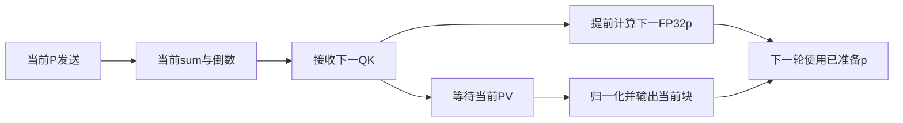

# 固定063源码：下一块FP32概率前瞻

当前已保留IR005120.9111μs、同轮CANN127.9771μs、1.05843963×CANN。IR005由CC/DeepSeek实施，Codex分析并审查；修改前读取/决策、语义、CPU编译、原四项与后双分析及绑定全部通过。

## 证据与改法

当前IR004同一veccore0窗口中，nextQK接收结束45.485μs、当前PV等待至46.412μs；后续两段为51.112→52.594和57.810→59.057μs。下一块的half转FP32、缩放与exp仍在PV返回之后；这些原本独立的计算可尝试放进等待窗口。

原reciprocal结果114688..114944及VMUL临时区114944..116992占用FP32p缓冲。IR005把它们分别放到180480..180736和180736..182784；FP32p区114688..180224得以跨当前归一化与输出存活，den180224..180480保持。所有边界为字节，最高182784B小于196608B；静态容量检查与事件/别名语义审查分别保存。

每组第一块沿原入口计算p；每次有效nextQK接收后立即消费MTE2→V EVENT1，再执行同一half转换、常量缩放和exp，后续迭代直接使用已准备FP32p。P的BF16转换和发送仍留在对应块原位置。48个非空组首块与464次守卫前瞻恰好覆盖512tile；EVENT1动态set/wait各512次。其他跨核信号与AIC保持原样，尾块不额外读取或计算。

图表达待设备核验的独立依赖；当前概率计算的真实重叠由后模拟器确认。FP32p必须避开当前输出归一化的临时写入。

## 审查与预测边界

IR SHA `0098dc08fafd07d4e91259a9141b6c87eec13e8584a01fef8c160576e7537433`；实际CPU二进制 `cacedae1b6c152de20a59c19def745df7ca34cbdc62089cbe959947b14c52020`，公共符号和参数ABI通过。AIC逐字一致；原每tile浮点运算、常量、精度与归约树保持，只有独立tile顺序改变。

模型原预测有口径偏差，已在上机前另存宿主纠正，原诊断保持：两处原有计算间屏障随计算移动，另增加每次前瞻一处屏障，逻辑净增464次；EVENT1等待迁移而非新增，总次数保持512。立即排队wait不代表等待耗时为零。核延迟预测应按最长worker的25/26tile及实际重叠讨论，不能把20个并行worker串行相加。逐位输出一致尚未实测，当前验收仍为原四项checker。

依据：[修改前与CPU审查](gqa-ir-qk-receive-prefetch/agent-calls/ir-005/host-review.json)、[模型实际diff](gqa-ir-qk-receive-prefetch/agent-calls/ir-005/model-ir.diff)、[预测口径纠正](gqa-ir-qk-receive-prefetch/agent-calls/ir-005/host-prediction-review.json)、[CPU结果](gqa-ir-qk-receive-prefetch/cpu-ir005/result.json)。

## 完整验收与真实收益

正式133.3206→120.9111μs，下降9.308014%；候选三次121.07315/120.75810/120.91110μs，同轮CANN128.54010/127.97710/127.33365μs，中位比值1.05843963×，超过原0.8目标并达到用户进一步希望超过CANN的结果。独立kernel136.642731→127.162544μs同向改善，按条件策略无需额外ABBA。本次独立CANNkernel125.702515μs仍略快，完整调用和kernel-only结论分开。

原四项case1/2/4/7均通过，完整调用99.47805/110.14110/120.91110/90.71705μs；官方checker的mere/mare/max_diff/mismatch_count均与父版一致。没有另加算子输入。冻结合同仍为warmup5、trials3、iterations20、seed1729+case_id、CPU uniform[-1,1]；checker/golden/harness身份与初始版本一致。完整20项仍为独立后续范围。

后重放同一veccore0：nextQK接收51.430–51.912μs，next半精度转FP32 51.915–52.082μs，next指数52.260–52.587μs；当前PV等待51.447–52.837μs、PV接收52.839–53.163μs。准备计算确实进入等待期，在PV返回前完成。三核时钟30/30、34/34、34/34；正式/profile/simulator绑定`cacedae1b6c152de20a59c19def745df7ca34cbdc62089cbe959947b14c52020`。partial/application_completed=false与完整正式四项分别保存。

MMAD2048、GM→L1 54MiB、L0C→GM48MiB保持；Vector每种子核合计GM→UB和UB→GM各24MiB保持。每tile算法不变，IR改变调度与缓冲存活安排。不能把两个不同采集窗口的指令动态总次数直接相减为全kernel变化。

依据：[保留记录](gqa-ir-qk-receive-prefetch/retention-ir-005.json)、[正式四项](gqa-ir-qk-receive-prefetch/validation-ir-005/results.json)、[后重放机制](gqa-ir-qk-receive-prefetch/post-ir-005/probability-lookahead-mechanism.json)、[计时策略](gqa-ir-qk-receive-prefetch/measurement-policy-ir-005.json)。运行该成绩使用[实际最佳manifest记录](gqa/retained-implementation.json)指定的IR注入；单独运行063源码对应源码版本，不能替代该IR实现身份。
