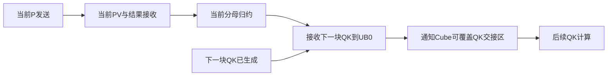
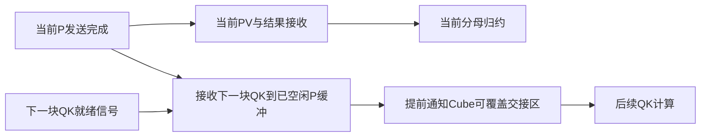

# 固定063原生倒数IR：更早接收下一块QK

当前已验收最佳为IR004的133.3206μs、同轮0.975701×CANN；IR003144.43715μs及原生倒数145.9246μs的原始参考记录冻结。本轮从已验收的原生倒数ir-001继续，保持源代码、数学、公开ABI、host和输出布局，只研究Vector端QK接收的流水位置。ir-003已通过原四项、后重放、身份绑定和条件交错，正式保留。

## 模拟器排除了一个简单改法

成对063profiling中，候选Cube计算、MTE1/MTE2/FIX累计时间及Vector计算、MTE2/MTE3累计时间都低于CANN，但完整kernel150.383011μs仍高于CANN122.662453μs；这提示研究重叠与交接，单凭累计量不能确定关键路径。

当前已验收IR001同一Vector核窗口：归约44.964–45.257μs，VREC45.258–45.271μs，VMUL45.287–45.468μs；下一QK GM→UB45.259–45.739μs，输出MTE3 45.596–46.498μs。下一块读取已经与归一化、输出搬运重叠，不能把源码/IR文本顺序当成硬件串行证据。因此未发起“仅移到归一化前”的无依据实验。

## 新的控制点与可检验机制

现有QK接收UB0..32768与分母归约临时区重用，V→MTE2 EVENT0只在归约后释放。要早于当前PV等待接收，需要其他死缓冲及明确的生产完成信号。

拟复用当前P发送完成后的UB32768..65536：第一块仍从UB0读取，后续块从此预取区读取，随后转为原FP32概率缓冲，再覆盖该区生成当前P。Cube已在当前PV之前生成下一QK，但当前跨核flag0要等PV FIX完成才发；拟给有效nextQK增加独立ready信号，由Vector在P发送/通知Cube之后等待并读取。对MTE3发送完成、下一QK可读、预取完成、GM区可覆盖和跨组UB0复用分别建立事件保护。

模型必须证明首尾、KV组交集、两个Vector子核、每条事件的生产/消费次数及无循环等待，保持原归约/VREC/VMUL计算与精度。新增同步可能抵消所隐藏的约0.48μs局部接收成本，真实收益待固定四项和后重放检验。Triton源码目前不表达此具体UB地址与跨核事件安排，因此研究晚层IR。

远端分支：`gqa-ir-qk-receive-prefetch`；模型ir-001 PID3940852。历史“删重复屏障”ir-002已完整通过，但交错145.3794→145.56115μs慢0.125%，未保留；本轮父版仍为原生倒数ir-001。

## 依赖关系：当前实现与待验证方案

当前实现中，下一块QK已由Cube生成，但Vector接收复用归约临时区，因此接收与覆盖许可仍受当前归约限制：

待验证方案将接收放进P发送后空闲的缓冲，用独立就绪信号保护数据：

图仅表达待审查的依赖变化，不把源码发射顺序或各核归一化时间直接当成已实现的重叠。实际Cube还受当前PV对L0C的占用约束，新的接收许可不能越过该硬件依赖。

## 首版提案审查与修复

首版模型ir-001未成功提交：模型自造的submit命令路径触发其工具允许列表检查，真实decision命令已经成功。没有请求用户批准，也没有伪造提交；原回复、工具结果、诊断与未提交IR均保留。

宿主发现确定的资源错误：新增32768B缓冲放在UB180480之后，结束213248B，超过实际196608B容量16640B；模型把1572864bits误当成字节容量。该IR未编译、未上机。此外，它把接收放在PV等待及acc读取之后，未实现本轮要求的PV等待重叠。保留为修改前研究负结果，并逐字节恢复已验收父IR。

已补充实际SDK能力依据：[事件接口原文及身份](qk-receive-event-capability/sources.json)。CANN9.0.0的matmul_impl.h第74–76行使用FetchEventID、SetFlag、WaitFlag<HardEvent::MTE3_MTE2>，批量拷贝实现也使用该事件；说明硬件API存在，具体HIVM表达仍需本机CPU编译确认。

新调用ir-002明确复用UB32768..65536，接收必须在P发送与flag1之后、当前PV的flag0等待之前；禁止增加越界缓冲或悄悄改为PV等待后的方案。模型PID3954391。静态固定case4分区为48次首块读取＋464次条件预取，见[分区审查](qk-receive-prefetch-partition-audit.json)。

## ir-002读取失败与ir-003合格交接

ir-002生成的缓冲复用提案符合容量，但其修改前profiling.json和frozen.py读取未成功，严格模型读取审查未通过。保留失败及原输出，不把宿主读取代替模型读取，也未将ir-002送设备。恢复实际保留父IR后，ir-003重新成功读取所需证据、登记决策并经Edit提交；输出字节与先前草稿一致。草稿阶段的CPU编译仅用于语法/ABI诊断，ir-003严格审查通过后才复用该精确字节编译回执并启动设备验证。

新IR SHA为`c3bfa79252997697a999f80291af3e0e38b678d5c4339fa22c603d3b9406fa1a`，真实父IR为已保留原生倒数IR001。静态UB最高结束地址180480B，小于196608B；此检查只验证常量连续视图范围，事件、别名与存活期由单独语义审查。首块48次、后续预取464次，QK总读取512次不变。P发送完成由MTE3→MTE2事件保护，nextQK ready使用跨核flag4，预取完成后发原flag2；组末保护下组UB0读取。CPU实际接受该事件表达。

原四项全部通过：case1/2/4/7候选103.9956/103.9796/144.43715/97.1126μs；目标同轮CANN125.18865μs、0.866734×。目标checker的mere0.0011375385281953124、mare0.007812493750005、max_diff0.0009765625，与实际父IR对应指标相同，仍只按冻结四项及原值域解释。约1.02%的历史计时差异触发一次相对实际保留IR001的条件交错；后重放和交错完成前不更新主图。

## 已验收收益与后重放

IR003已保留：正式145.9246→144.43715μs，下降1.0193278%；同轮CANN125.18865μs、原始0.866734×。上版CANN130.3856μs较慢，导致上版原始0.893513×更高；连续图统一新参考锚点，历史原件保持。固定四项耗时几何下降（相对本轮起点）为46.870297%，四项各自的计时波动与单目标收益分开。

相对实际保留倒数IR001的一次条件交错A/B/B/A：145.52465/144.99765/145.18115/145.93565μs，中位145.73015→145.0894μs，下降0.439683%，两次候选均快于两次原版。独立kernel152.443054→146.702927μs，支持同方向改善，单独计量。

正式/profile/simulator二进制一致为`685dc4d6c17c874b4d64244dde044f830228020a8bb76c0b4aa7d51a0a252d4b`。三核时钟30/30、28/28、28/28；application_completed=false及部分窗口照实保留，正式四项独立完整完成。profiling总MMAD2048、GM→L1 54MiB、L0C→GM48MiB保持；Vector单子核合计GM→UB/UB→GM各24MiB保持。两Vector子核的总量须分别汇总。

同一veccore0窗口：P发送40.867–42.787μs；新flag4等待39.588–44.480μs；下一QK接收44.486–44.968μs、完成信号44.969–44.971μs；PV等待44.488–45.895μs、PV接收45.897–46.221μs。接收确实与PV等待重叠，避免跨核原点比较。sum仍46.336–46.886μs、VREC46.887–46.900μs，成为下一轮候选控制点。

完整依据：[保留记录](gqa-ir-qk-receive-prefetch/retention-ir-003.json)、[正式四项](gqa-ir-qk-receive-prefetch/validation-ir-003/results.json)、[后重放机制](gqa-ir-qk-receive-prefetch/post-ir-003/qk-receive-mechanism.json)、[条件交错](gqa-ir-qk-receive-prefetch/conditional-stability/ir-003/summary.json)。IR003的编译回执沿用精确同字节ir002草稿，但合法修改前读取/决策与提交身份为ir003；两个阶段的原件和时序均保存。

## 下一步：独立归约与倒数提前

IR004从当前保留IR003出发，将同一sum/VREC链移到P发送和flag1之后、nextQK/PV等待之前；候选由模型实施。当前QK预取使用UB32768，而sum scratch使用已释放UB0；VREC覆盖FP32p前必须完成sum。两核事件、浮点表达式、缓冲地址和AIC保持。旧059上的sum提前负结果随模型输入保留，本次属于前瞻、原生倒数和新接收缓冲组合后的独立检验，当前尚无新成绩。

IR004模型已交接，实际diff为16行sum/VREC链纯移动；操作文本多重集合、AIC及所有其余字节保持。严格读取审查通过，CPU编译/公共符号/参数ABI通过，IR SHA`c0dcca3e64078a91ee596c693946689fd08444f385a2cb1e3831f09b19e842ab`。首次宿主执行缺少容器内hivmc，编译器尚未执行；错误原件保存后，在既有tle_yy SDK环境成功编译。原四项与后双分析PID3991441运行，未保留新成绩。[语义与CPU审查](gqa-ir-qk-receive-prefetch/agent-calls/ir-004/host-review.json) · [实际diff](gqa-ir-qk-receive-prefetch/agent-calls/ir-004/model-ir.diff)。

IR004原四项已通过，case1/2/4/7完整调用106.1601/102.8546/133.3206/92.5676μs；目标CANN130.0811μs、0.9757×，候选三次132.75815–133.32910μs。独立kernel136.642731μs，较IR003146.702927μs同向改善。后重放仍在运行，当前未更新保留成绩。

## IR004完整验收：同一计算移入等待期

已保留133.3206μs，同轮CANN130.0811μs、0.975701429×。较IR003下降7.696462%，三次候选132.75815/133.32060/133.32910μs，独立kernel146.702927→136.642731μs同向改善。收益明显高于近期波动，没有新增条件ABBA。四项耗时geomean相对本轮起点下降48.418578%；目标和四项汇总分别解释。case1/2/4/7官方checker的mere/mare/max_diff/mismatch_count均与父版相同。

同一veccore0窗口：sum41.380–41.931μs、VREC41.932–41.945μs，已经与P发送41.376–43.306μs及nextQK ready等待41.396–44.998μs重叠；PV接收46.414–46.738μs，归约不再排在它之后。三核时钟均30/30；正式/profile/simulator绑定二进制`6e1877f81e3592572f0a5867c542ad54f4d45ac97787726398a14d4803bd16c3`。partial/application_completed=false与完整正式四项分别保存。

MMAD2048、GM→L1 54MiB、L0C→GM48MiB保持；Vector每种子核合计GM→UB及UB→GM各24MiB保持。此次收益来自调度重排的实验，数学和逻辑流量保持，流水内部的所有变化仍以真实后数据解释。此前059的sum提前负结果继续存在；当前063前瞻、接收复用与原生VREC的组合条件不同。

依据：[保留记录](gqa-ir-qk-receive-prefetch/retention-ir-004.json)、[正式四项](gqa-ir-qk-receive-prefetch/validation-ir-004/results.json)、[后重放机制](gqa-ir-qk-receive-prefetch/post-ir-004/sum-reciprocal-mechanism.json)、[计时策略](gqa-ir-qk-receive-prefetch/measurement-policy-ir-004.json)。

## IR005：下一块FP32概率前瞻

新窗口中，下一QK接收结束45.485μs，当前PV等待至46.412μs；另外两段为51.112→52.594、57.810→59.057μs。下一tile half→float/缩放/exp仍在PV返回之后，因此模型检验把这段独立计算提前。先将current reciprocal和VMUL scratch移出FP32p区：拟分别180480..180736与180736..182784，容量196608B；保护下一p在当前归一化期间存活。P的BF16转换/发送保持各自原tile位置，48首块＋464前瞻的每tile算术保持。新方案模型PID4002327，尚未取得设备结果。
