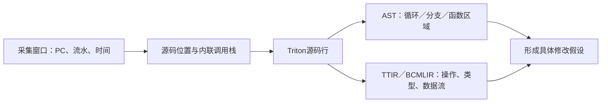

# GQA：采集窗口到 Triton 源码的映射与昇腾编译链

2026-11-22。用于技术点2的讲解准备，不修改已有trace或生成PPT。

## 两条方向不同的链

编译方向：Triton Python源码／AST → TTIR → Ascend适配的Linalg等MLIR → 毕昇NPU编译流水 → HIVM等硬件相关IR → 后端代码生成／链接 → NPU二进制。

观测回溯方向：模拟器采集窗口 → 同kernel、同core的指令PC与时间 → 编译器源码位置／内联调用栈 → Triton源码行 → AST循环／条件／函数区域。另以对应TTIR／BCMLIR确认张量类型、操作及数据流；以晚层IR理解缓冲和事件。



AST在这里承担源码结构定位。PC与源码行的桥接来自采集记录中的源码位置信息；不能省略这座桥，也不能把AST从流程中省掉。

## 实际代码入口

- `hgkda/src/hgkda/simulator.py:75`：按PC关联`*_instr_exe.csv`与`trace.json`，解析`args.code`中的文件／行号，保存完整`source_stack`。
- `hgkda/src/hgkda/regions.py:81`：`source_scopes`解析经身份核对的源码AST，提取循环、条件、函数起止行。
- `hgkda/src/hgkda/regions.py:101`：`region_key`将已有源码位置归到对应AST区域。
- `development/tools/research/gqa_simulator_schedule.py:49`附近：按完整源码调用栈匹配目标表达式，再用PC关联逐次执行区间。

## 已核实的 QK 热点实例

输入源码：`gqa/agent-calls/attempt-033/input-source.py`，SHA `e7fad4d8519526ea1731371e47d7ddb1417300145d28d14f4dca49bffbabee9b`，对应修改前031版本。

同一版本的`gqa/iterations/attempt-031/simulator-parent/listing.json`记录：

| 字段 | 值 |
|---|---|
| 硬件核 | core0.cubecore0 |
| PC | `0x10d11568` |
| 指令 | `FIX_L0C_TO_DST` |
| 流水 | FIXP |
| 窗口内调用次数 | 19 |
| 窗口累计时间 | 83.489998 μs |
| 内层源码调用栈 | `candidate.py:217` |
| 外层调用位置 | `candidate.py:288` |

217行实际源码：

```python
qk = tl.dot(q, tl.trans(k)) * qk_scale
```

本次静态AST检查确认：217行位于`_gqa_tile_part_body`（146–251行）、外层循环（180–251行）、内层query tile循环（205–251行）。

历史自动区域摘要采用`source`的外层288行，归到282–295行条件区域；完整`source_stack`另保留内层217行。具体QK判定使用内联栈和实际IR对照。本次核查未将历史自动摘要改写成已经直接选中了内层循环。

实际TTIR第99行：

```mlir
%qk_45 = tt.dot %q, %qk, %cst_5
  : tensor<128x128xbf16> * tensor<128x256xbf16>
  -> tensor<128x256xf32> loc(#loc217)
```

其中`#loc217`是MLIR位置别名，并非自动等于Python217行；必须沿`loc`定义解析。该文件另有指向`candidate.py:217:40`等位置的定义。

实际BCMLIR第98行：

```mlir
%54 = linalg.matmul {input_precision = "ieee"}
  ins(%52, %transposed : tensor<128x128xbf16>, tensor<128x256xbf16>)
  outs(%1 : tensor<128x256xf32>) -> tensor<128x256xf32> loc(#loc162)
```

关联后得到“热点是QK的FP32结果交接”。随后才提出FP16交接、接收后恢复FP32的源码修改，并通过修改后IR、profiling、重放和原checker核验。

## TTIR 与 BCMLIR 的关系

用户提到的TTL在当前材料中对应TTIR（Triton IR）。它保留`tt.load`、`tt.dot`等Triton张量操作及类型和位置。

本机捕获同时包含`.ttir`、`.ttadapter`、`.mlirbc`、`.bcmlir`、`.npubin`。已核对本地固定版本triton-ascend后端`compiler.py`的`add_stages`以及实际GQA产物：

```text
Triton源码
  → AST / 前端生成
  → TTIR (.ttir)
  → ttir_to_linalg (.ttadapter)
  → MLIR bytecode (.mlirbc)
  → 毕昇读取bytecode、导出MLIR文本 (.bcmlir)
  → bishengir-compile：HFusion / HIVM等编译阶段
  → 后端代码生成与链接
  → NPU二进制 (.npubin)
```

BCMLIR在该链路是bytecode桥接后交给毕昇的MLIR文本产物，实际仍可见`linalg.matmul`、`arith`、`math`、`tensor`等操作。它不是机器码，也不等于晚层HIVM；不要将“TTIR→BCMLIR”直接画成已经完成硬件指令选择。

实际063请求调用CANN9.0的`bishengir-compile`，目标`Ascend910B4-1`，开启debug info、hfusion、hivm、triton-kernel编译选项。当前研究中固定源码的事件／缓冲／归约重排修改发生于另行捕获的晚层HIVM，而非只修改Triton的AST。

本说明按当前GQA实验链组织；其他版本或SIMT编译路径可能有不同阶段。

## compact 图案例（已落实）

紧凑图保留0、6、7、11、19、22、23；主讲节点7、11、22用独立方框强调，辅助节点6、19、23保留。

- 索引7：共享KV持久复用（0.476×），对应成对profiling。
- 索引11：QK交接缩窄（0.652×），对应模拟器热点。
- 索引22：独立分母归约移入等待期（0.960×），对应模拟器流水空泡与IR重排。
- 索引19作为模拟器指导Triton前瞻的桥接；索引23展示概率前瞻后的最终收益。

完整图同步标出相同节点数值，继续保留0–23全部有效进展。原始事件、性能和归因保持不变。
