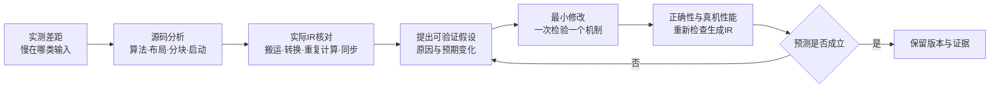

# 源码与实际IR的机制分析

方法：实测提出问题，源码定位实现，实际IR检查编译结果，以最小改动和重新评测验证机制。仅看到源码变化不能证明历史Agent实际做过该分析；这是后续明确执行和记录的方法，不倒填历史归因。

实际IR必须绑定当前源码SHA、输入、编译配置及产物，不能用旧IR解释新候选。源码分析回答“写了什么”；IR检查回答“编译出了什么”；模拟器进一步回答“执行中何处耗时或等待”。前三者不能互相代替。

例如GQA中，实际IR可统计循环内矩阵乘数量，模拟器可观察对应执行和等待；减少一次PV后，须同时核验精度、IR数量、相关窗口指令变化和真机耗时。当前预实验包含模型修改及Codex审查反馈，不能证明该方法只有模拟器才能发现。
