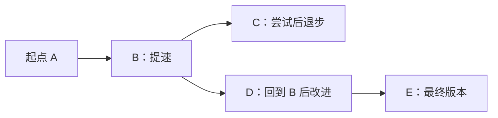

# 优化主线、trace索引与轨迹展示计划

日期：2026-11-16。状态：log10试点已实施；六项及26项复用仍为后续范围。[试点交付](log10-trace-pilot-20261116/index.html)包含12点主线、3点模拟器放大及原28点历史入口，冻结原件保持不变。

实施新增`development/tools/traces/`通用导入／绑定／渲染入口，索引在`development/manifests/traces/log10_/`。已通过字面写入及替换日志恢复前10次模型调用，后14次输入／输出与保存快照一致；正式源码、请求和结果均已绑定。连续JSONL保留中间修改、未正式评测的预检失败及无修改调用；外层控制器事件以源码锚点加入，缺失时间仍为空，不宣称完整精确的全局时间顺序。下文保留原方案与后续扩展顺序。

## 1. 目标与展示原则

主图聚焦一条可理解的优化过程：哪里慢、看了什么、为何修改、结果怎样。全量记录继续可见，但不把七个重新起步的批次并排堆成主叙事。

保留三种视图，它们由同一份索引生成：

| 视图 | 回答的问题 | 展示内容 |
| --- | --- | --- |
| 主线图 | 这一实现是怎样优化出来的？ | 一个实验目标及可追溯的候选演化；所有已测节点保留，只标少数关键方法箭头 |
| 方法放大图 | 某项分析如何影响一次具体修改？ | 修改前证据、假设、对应源码／IR、修改及结果，通常2～4个性能节点 |
| 全量历史图 | 这个算子一共尝试过哪些实验？ | 已收集的所有批次、分支、失败及复验，支持查询、跳转和导出 |

现有log10的28节点图保留为全量历史图。用户明确要求全部28点时仍在同一张图面展示，不以菜单数量替代实际节点数。默认汇报入口改为主线图，主图角落标明“本线N点／已收集总量M条”，避免再次混淆数量。

数量遵循真实记录，不能为了线长而跨批次连接，也不能为了曲线好看只画递增包络。失败、退步和恢复均保留。

## 2. 已核对的现状

### 2.1 存储与绘图数据

- 独立工作流原件在`development/experiments/skill-validation/<批次>/`。模型调用、候选尝试、正式KGS、补充检查及分析附件按不同目录保存。
- 模型调用的`agent-events.jsonl`、输入／输出源码和`source-provenance.json`可用于恢复源码变化；`formal-<SHA>/operators/<算子>/candidate.py`与`evaluation/result.json`用于绑定实际性能。
- 旧KG实验的`.ledger.json`、逐轮结果和事件位于已有归档或910B的runs目录，初步提取记录保留原路径与SHA。
- `development/reports/operator-traces-history-20261116/traces.json`是当前展示用提取数据；`log10-all-28.json`另含28点和21条箭头，二者不是全部原始trace。
- 当前图主要按批次和正式评测顺序组织，尚未形成跨批次的统一候选演化索引。

### 2.2 log10试点的具体证据

当前已收集7批、28条正式评测记录。其中独立开发12份正式结果，冻结重生成4份结果，模拟器区域修订3个节点，其余为较早批次。

独立开发有24次模型调用、17份设备预检源码、12份正式结果。模型调用中可能发生多次编辑、编译失败或保持源码不变，不能等同于12次直接父子修改。

本次只读检查发现：

- 第11～24次调用共14份`source-provenance.json`，相邻调用的输入／输出SHA连续；其中2次不改变源码。
- 前10次调用没有同名来源文件，需要从已有输入／输出快照、事件和生成审计中补索引；无法证明时明确保留缺口。
- 第11次调用以`09de10b0b5ce…`为输入，输出正式候选`0fefe838c58c…`。前者不是前一个正式结果的源码，所以相邻性能点之间可能有未正式评测的中间修改。
- 第23次调用明确以`69699663ecc7…`为输入，输出`8600ce070318…`，对应0.761426×→0.851055×，可直接建立源码演化边。

这些事实说明应同时保存“候选怎么变”和“什么时候测了性能”，不能只存分数数组。

## 3. 怎样定义并选择一条优化主线

一条主线需要同时明确三件事：

1. **实验目标一致。** 明确起点和终点，区分开发、冻结重生成、既有源码复验与专项诊断。
2. **结果可比较。** 参考实现、case集合、精度要求、完整调用计时、统计方式和运行环境相容。bundle相同本身不足以证明全部口径相同。
3. **版本关系可说明。** 优先使用输入／输出SHA与编辑事件，辅以ledger明确的父轮次。只有时间顺序时，标为“尝试顺序”，不冒充直接继承。

从目标终点反向查找实际来源，确定主干。中途的失败若仍是后续版本的祖先，留在主干；若退回旧版再另试，失败版本画为短分支。重新从FlagGems生成属于另一条实验线；方法复用关系与源码继承关系分别记录。

例如：

图中C仍展示，但不能把它画成D的源码父版。若C没有有效性能，不把分数设为0；在相应位置标编译／正确性失败。

同一份源码在不同环境或不同时间复验，属于新的评测事件。是否复用内容与是否新做测量分开计数。

## 4. 首个主线与方法案例怎么选

先用log10独立开发批次做展示试点：已有12份正式结果和具体方法记录，整体从0.163022×到0.851055× CANN。实施时先恢复来源关系，再决定展示为连续主干还是带少量分支的尝试过程。

主图保留12个正式点，先选4个解释力较强的转折作为箭头候选：

| 位置 | 方法 | 重点说明的信息来源 |
| --- | --- | --- |
| 有限网格循环 | 调整每program处理量 | 已有方法或本次探测的具体来源；未查明就标待核验 |
| 0.403237×→0.641437×附近 | 减少重复模式查询 | 宿主诊断与启动路径检查 |
| 热路径整数地址 | 减少逐次参数处理 | 本机启动ABI／后端源码及测量 |
| 0.761426×→0.851055× | 低精度数学保持输入dtype | 实际IR中的类型转换变化与正式结果 |

这里的“附近”不先认定直接源码父子关系，最终以恢复出的来源链为准。

模拟器区域修订单独作为方法放大图：0.915250×→0.750783×→0.833512×。它用于说明等待、区域及IR如何影响预取与循环携带修订，保留退步和恢复。不能把它直接接到开发版0.851055×之后；中间存在独立重生成、相同源码复验等不同事件。

这两个视图各有清楚的问题，不把开发主图改造成模拟器贡献证明。其他算子的模拟器案例继续沿已有资料选择，不为维持log10案例而安排新设备实验。

## 5. trace索引的最小数据模型

保留原始目录字节，只建立可重算的轻量索引，首个位置建议为`development/manifests/traces/log10_/index.json`。图片仍在`development/reports/`，已有交付索引`operators/index.json`继续只负责交付状态。

最小索引包括六类对象：

| 对象 | 最少记录什么 | 目的 |
| --- | --- | --- |
| 实验线 sessions | 算子、目标、起止、起点、方法版本、模型配置、合同与环境ID | 区分开发、重生成、复验及诊断 |
| 源码 snapshots | SHA、原件路径、是否存在 | 用内容身份引用源码，避免复制实现 |
| 变化事件 transitions | 输入／输出SHA、来源事件、动作类型、调用编号、证据位置、关系确认状态 | 还原修改、回退、重启、无修改调用 |
| 正式评测 evaluations | 独立ID、源码SHA、合同、参考、设置、环境、结果路径、正确性及性能 | 将性能绑定到实际源码和测量口径 |
| 分析证据 evidence | 类别、绑定源码、case／kernel、文件SHA、时间、提供／读取／决策引用记录 | 说明修改参考了什么 |
| 展示 views | 主线选择、节点、关键箭头、隐藏分支入口、文字与出处 | 同一事实生成主图、局部图和全量图 |

重要约束：

- 源码内容相同不意味着是同一实验事件。回退到旧SHA、同源码复验分别记录，避免以SHA为唯一节点把演化图接成环。
- 正式评测之间可以有多个未测变化事件；可以在主图合并为“含若干中间修改”的连接，详情必须能展开。
- 父子未知就保留未知。相似diff、相邻时间、同一文件名不能单独证明直接继承。
- 同一源码对应多个测量时，各次原始分数保留，不自动取最高值或平均值。
- 方法与标签文字由展示数据维护，并带出处；渲染器不再按源码SHA或固定第几个点写死优化方法。

## 6. evidence标签怎样做到准确又易读

图面使用当前已有的P成对profiling、S模拟器、I源码／IR、E专项探测及“来源待核验”。历史方法确有明确记录时可直接写“历史方法”，不强行扩展成每张图都有的图例。

对每次修改分别记录：证据已采集、已提供给模型、模型实际读取、决策明确引用、事后验证。它们是使用过程状态，不是严格的因果强弱分数。

- 同一段修改同时引用模拟器与IR，可标`S＋I`，并写简短的“等待集中在该循环”。
- 一份模拟器文件只在修改完成之后出现，记录为事后验证，不标为该次修改的触发来源。
- 只有数据存在、没有读取记录时，图中写“来源待核验”或具体已知来源，不自动写成综合证据。
- 多项修改一起评测时，方法文字列出组合，不把总提升分配给其中一个工具或动作。
- 改法由谁提出、源码由谁生成保存在详情，保持Codex与CC／DeepSeek的真实分工。

缺失标签不阻止先出图。优先补当前主图关键箭头，其余节点的详细归因按需要补充。

## 7. 主图的版式

延续已认可的米色底、深色文字、绿色轨迹和来源分类色。

- 16:9画布，一条主线；主图建议约8～15个有效性能点。实际主线更长时保留节点，可分页或提供全图，不截断后声称完整。
- 每个点显示相对固定参考的正式性能；有失败或退步仍保留。源码关系分叉时画短分支，不伪装成单调上升曲线。
- 节点以直线连接，保留批次或可比性断点，不使用90度阶梯线。
- 每图先标3～4处关键箭头，最多约5处；其余方法在HTML悬停／展开或伴随表中查看。
- 每个箭头两行：第一行是具体优化动作；第二行是evidence来源类别及必要的短观察。箭头指向对应版本或变化边。
- 注释尽量在目标点附近，避免现在跨越整张图的长箭头。背景只划分实际优化阶段，不为每个点单独涂色。
- 标明“本线节点／已收集总量”，附全量历史图入口。显式要求全部节点的图继续提供独立导出。

## 8. 实施顺序及每步交付

### 第一步：先把一条线选清楚

读取log10开发批次的正式结果、调用来源及实际快照。输出一份轻量试点索引与待确认的来源边，明确哪些是代码继承、哪些只有尝试顺序。

完成条件：12份正式结果均绑定实际源码；第11～24次已有来源记录可用；前10次缺口被恢复或明确标注。不能因为某条早期来源边缺失就暂停整个展示。

### 第二步：交付简洁主图

按同一份索引生成12点开发主图及HTML详情，标3～4个关键方法／evidence箭头；保留28点全量图作为历史入口。另提供模拟器3点放大图，方法与结果解释就近呈现。

完成条件：主图节点数与索引一致；关键方法箭头能回到出处；分支和未知关系不会被画成已确认继承；PNG／SVG及HTML实际检查文字、箭头及节点遮挡。

### 第三步：整理为通用工具，再覆盖首批六项

把导入、索引核验、主线选择和渲染集中为一套可参数化的研究工具。现有`development/tools/lineage/build.py`与`render.py`负责三类交付版本，不挪用其名称或改坏现有职责；轨迹渲染脚本逐步收敛，旧图保留追溯。

不继续为每个算子复制一个渲染脚本。先把SELU恢复线用于检验复用，再覆盖首批其他四项；某项只有3个已知正式点就如实展示3个，不凑节点。

完成条件：同一入口可换算子、实验线及视图；数据换了无需改渲染代码；六项各有主线入口及全量历史入口。

### 第四步：覆盖26项，并改善新实验记录

用相同导入规则整理其余20项；没有足够记录的项明确显示缺口。后续新实验在每次模型调用与正式评测时自动写出来源、证据使用和结果关联，减少事后人工追溯。

新记录优先复用已有模型／评测runtime的事件与快照位置，先完成离线索引；稳定后再决定哪些通用记录能力进入hgkda包，不把本轮汇报脚本直接发布为skill核心。

## 9. 本轮交付边界与检查

这一轮是历史trace整理和展示改进，不需要重新生成算子或重测性能。冻结原件与交付ZIP保持原身份，新增索引和导出由现有数据重算。

必要检查集中在：源码SHA对应、评测口径、显式父子关系、完整节点计数、无分数失败的呈现、关键箭头出处及实际可读性。工具校验不能替代历史因果证明；归因材料不完整也不能成为拒绝画图的理由。

实施优先级：**一条能读懂的主线图 → 方法局部放大 → 六项可复用 → 26项历史覆盖 → 新实验自动记录。**
