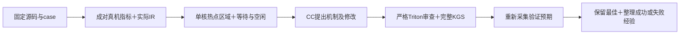

# 工程收敛与热点区域诊断验证

日期：2026-11-10。状态：完成。本轮完成工程收敛、两项独立入口复验，以及`log10_`区域诊断进入真实模型输入的验证；交付仍为26/30。

## 本轮范围

完成通用／算子专项工具收敛和三端同步，复验已有SELU、log10候选，并在主线30项内选择一个具体性能短板验证区域诊断方法。早期9项退出新实验，不新增交付数量目标。候选全部修改由CC／DeepSeek完成；Codex负责方法、工具、只读审查和外层调度。

## 工程与既有候选复验

通用入口为`python -m tools.skill_validation`；专项检查与参考适配集中到`tools/operators/<operator>/`，旧候选补丁／调度工具保留在`tools/archive/`。根README维护稳定能力，开发状态在`docs/DEVELOPMENT.md`维护。

| 固定候选 | 本轮相对CANN | 完整KGS | PyTorch／CANN补测 | 专项检查 |
| --- | --- | --- | --- | --- |
| `selu_`，`5e9e4d482620` | 0.949923× | 36/36 | 各42/42 | 偏移9/9，指针／stream等24/24 |
| `log10_`，`45c7380a8062` | 0.915250× | 36/36 | 各66/66 | 特殊值／尾块15/15 |

这是固定源码在整理后入口的复验，不是新生成或性能提升。既有交付仍为26/30；四批审计重新核验1159条传输清单记录，重建28条正式记录，其中23条固定回归验收加3条后续修复／参考补齐，共26项当前交付。历史版本索引另核验384份关联文件。

## 区域诊断进入实际模型输入

新增独立`hgkda.simulator`公开CSV／trace解析器，并由`collect_simulator.py`连接采集、解析、区域统计和上下文。分析核心继续只依赖Python标准库。

1. 固定源码、case、候选符号和单个硬件核，校验原始时间轴；不混合整卡或多核事件。
2. 以同PC的非同步指令CSV累计时间交叉核验时间单位，排除低于0.1μs的舍入项。BAR／SET_FLAG／WAIT_FLAG可能有标记或入队等待口径差异，不参与单位校准，仍保留在热点和时间轴分析中。
3. 按源码AST循环／条件区域聚合热点。单核、同窗口内逐流水计算互斥区间：`有效指令并集＋仅等待并集＋未观测到执行的空闲＝观察窗口`。
4. 将区域、等待／空闲统计与成对指标、实际IR和分类知识送入CC真实调用输入；保存输入源码SHA、方法清单和模型工具轨迹。

`idle`不自动等于因果停顿；指令CSV累计时间也不等于可相加的关键路径。源码`tl.store(..., tl.log(x) * 常量)`所在行同时包含计算与写回，不能仅凭热点映射到该行就认定写回带宽是原因。

## log10大输入方法实验

对象为`log10_-timing-3`：FP16、`[4096,4096]`。固定候选真机任务39.260784μs，CANN参考25.100502μs；候选512个program，搬入指令2036条，参考760条；平均搬入粒度分别约16.48KB、44.15KB。两侧逐block均值不能直接作全任务耗时比较。

基线单核时间轴中，MTE3仅等待占57.45%，Vector空闲占40.76%。CC实际输入保存2份IR、5个源码区域及该时间轴。

第一项修改为64个program、相邻8192元素双块预取和编译期循环。源码`25e8b11f2c2f`完整36/36及双方各66/66通过，正式性能0.750783× CANN，低于本轮固定起点0.915250×；目标case完整调用43.802228μs。真机任务49.640991μs，平均搬入粒度约5.41KB。该方案不替换交付候选。

| 同核、各自窗口内的比例 | 固定起点 | 相邻双块预取 | 循环携带修订 |
| --- | --- | --- | --- |
| MTE2仅等待 | 0.00% | 76.82% | 58.12% |
| MTE3仅等待 | 57.45% | 41.33% | 39.87% |
| Vector仅等待 | 16.96% | 48.97% | 40.42% |
| Vector空闲 | 40.76% | 3.53% | 2.41% |

**更低的空闲比例并未带来更短的任务时间。** 取证显示等待转移至MTE2／Vector，搬运切分增多；源码中的双块预取不足以证明有效流水重叠。工作流将反例和完整性能交回CC，由其将首块载入移至循环外，每轮先载下一块、处理前一块，并在循环外处理尾块。实际bcmlir保留`scf.for ... iter_args(... tensor<8192xf16>)`，确认循环携带值仍在；这一IR形式不直接证明物理双缓冲。

修订后真机目标任务由49.64降至43.32μs，模拟器MTE2／Vector仅等待也下降；平均搬入粒度仍约5.41KB，完整成绩恢复至0.833512×，仍低于本轮起点。FP32大输入同时退步，因此保留原交付版本。

| 本轮版本 | 源码SHA前缀 | 相对CANN | 完整KGS | 双方补测 |
| --- | --- | --- | --- | --- |
| 固定生成起点复验 | `45c7380a8062` | 0.915250× | 36/36 | 各66/66 |
| 相邻双块预取 | `25e8b11f2c2f` | 0.750783× | 36/36 | 各66/66 |
| 循环携带修订 | `cbb329b76639` | 0.833512× | 36/36 | 各66/66 |

最终修订另通过15/15特殊值／尾块检查。两份新源码各执行一次正式完整评测，未对同一源码反复测量挑分。起点是已经生成的候选，`prior_best_source_provided=true`；本轮是针对性修改验证，不是从FlagGems重新生成最佳版本。原交付的SELU 1.039292×、log10 0.940911×原件保持不变。

本轮共3次模型调用，包含一次轮次上限退出和一次因提示词传输编码错误中断的调用；两者均保留原始记录。最后一次正常完成修订。生成轨迹可重放解释两份候选字节；Codex直接修改候选次数为0。中断调用读取过固定方法包的工具源码，该文件逐字节匹配60文件方法清单，不含外部最佳实现；此读取明确记录为开发期方法工具访问。

真机查询为20个Cube核、40个Vector核；本次`Ascend910B4`模拟器初始化暴露24个AIC、每AIC两个Vector子核。两者的激活核数不同，模拟器窗口不能当作真机延迟预测；此处比较模型内的区域现象，收益由真机完整评测确认。

模拟器原始退出状态单独保存：目标调用及`torch.npu.synchronize()`成功返回后写出的独立IR清单用于核验kernel完成；应用随后139退出仍保留为异常，不称为干净进程运行。超时采集和Python异常采集不按此条件接纳。真机、模拟器编译产物分目录，防止覆盖。

## 复现入口与证据

核心入口为`python -m hgkda`，skill为`skills/hgkda/SKILL.md`。服务器显式动作见`python -m tools.skill_validation --help`，其中`simulate --help`说明采集与解析参数。`context --listing ... --regions ...`将绑定的区域结果加入模型上下文。

原件位于[本轮证据](../benchmarks/skill-validation/20261110-regions/README.md)，包括方法快照、真实模型输入输出、审查、完整KGS、成对采集和模拟器原件。Windows核验57份复验文件及2750份方法实验文件；三份时间轴逐区间精确复算，区域累计值按跨Python版本1e-12浮点容差核验。性能失败记录已通过`curate/retrieve`实测，并作为有作用域的反例纳入包内知识；这次知识更新发生在生成结束后，不声称模型已使用更新后的反例条目。

服务器运行目录为`runs/overnight-regions-20261110-v1/`。外层取证、只读审查和调度仍由Codex承担。
