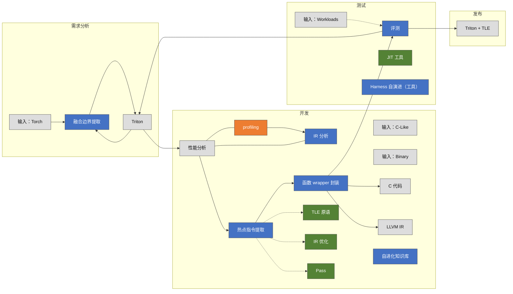
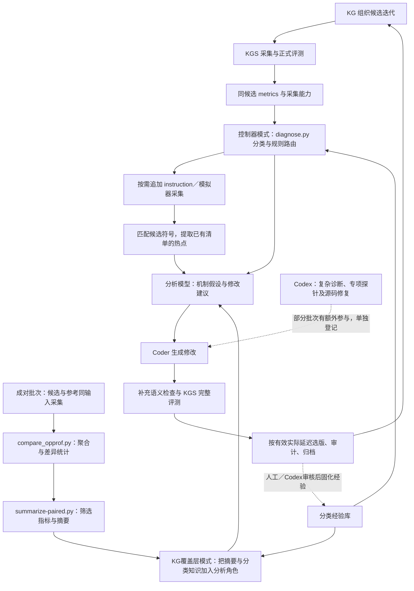

# 导师总工程与 HG-KDA 当前贡献

更新日期：2026-10-26。

原图：[workflow.png](../project/Ascend-Optimization-v1/temp/workflow.png)。它是导师提供的总工程设计资料；下文先转录设计，再对照本仓库的实现。原图的模块状态不代表本项目已经实现这些模块。

## 一、HG-KDA 现在是否独立

**HG-KDA 已有独立目录、标准 `SKILL.md`、分类知识库和分析脚本，可以作为扩展接入 KG；当前运行仍依赖 KG/KGS，不是替代它们的完整编译与评测平台。**

| 独立的含义 | 当前情况 |
|---|---|
| 有自己的方法、知识和代码 | 有，主要位于 `project/Ascend-Optimization-v1/tools/profiling/hgkda/` |
| 可以单独读取数据进行诊断 | 可以，比较、摘要和规则脚本可以离线处理既有产物 |
| 可以插入 KG | 可以，覆盖层扩展原生分析角色；另有控制器适配模式 |
| 有独立模型服务或完全独立运行时 | 当前没有；模型由接入流程调用，测量、profiling 和正式评测继续使用 KGS |
| 所有交付成绩均由该 skill 自动生成 | 不是；部分诊断、源码整合及修复由 Codex 完成，各批次分别记录 |

skill 是诊断方法入口，脚本负责确定性处理，模型负责解释机制和生成建议，KG 组织迭代，KGS 提供采集与评测。可插拔的方法模块和独立部署的完整系统，是两个不同层面的能力。

## 二、导师原图转录

原图按“需求分析 → 开发 → 测试 → 发布”划分阶段。下图保留主要节点、反馈路径、基础设施及原图颜色含义。

- 橙色：原图标记“待增强”；蓝色：“待开发”；绿色：“已支持”。这是导师总工程的状态标记，不是对 HG-KDA 的验收。
- `C-Like` 和 `Binary` 在原图中仅列为开发阶段输入，没有明确接线，因此本图也不额外推导它们的输入接口。
- 原图中 wrapper 分别指向 C 代码、LLVM IR；这里保留连线，不据此断言具体的代码导出、插入或编译接口已完成。
- 原图的性能分析下含 profiling 和 IR 分析，两者共同支撑定位。知识库、Harness、JIT 在原图中作为基础设施单列，未给出完整调用边。
- 原图编号 1、2、3 未附完整语义说明；本图不把编号解释成已实现的三套算法。

原图下方列出三类关键技术：跨芯自进化分层知识库（知识层级、优化策略）、热点指令提取（性能分析、按功能模块提取）、JIT 工具（支持 IR 和 C-Like 语言编译）。

## 三、HG-KDA 实质贡献对应哪些部分

**主要贡献是性能分析增强、指令热点辅助、分类经验库和评测反馈；融合边界提取、通用 wrapper、编译器 Pass 与跨语言 JIT 仍属于总工程其他层。**

| 导师图中的部分 | HG-KDA 已贡献什么 | 当前实现与证据 | 当前边界 |
|---|---|---|---|
| profiling／性能分析 | 同输入候选与参考成对采集；比较搬运量、搬运指令、流水活跃时间、等待与冲突；计算平均搬运粒度 | `collect-paired.py`、`compare_opprof.py`、`summarize-paired.py`；log10_/selu_ 成对批次 | 成对方法参考导师的 `msprof-op-compare.zip`，本项目贡献是910B适配、校验、统计及KG接入；当前采集器含两算子专用筛选逻辑 |
| 分阶段诊断／IR 分析 | 按算子类型、流水重叠等情况建议升级指令采集；结合实际 launcher、IR、源码解释额外转换、搬运与索引 | `diagnose.py`、`hgkda_adapter.py`；成对、缓冲及后续收尾批次 | 规则路由和部分采集已自动化；复杂IR因果解释仍主要由模型或Codex完成，没有通用IR优化器 |
| 热点指令提取 | 在成功取得的指令清单内，匹配候选 jit 函数，按指令观测时间／周期排序，排除输入构建kernel | `hgkda_adapter.py::instruction_hotspots` | 是已有KGS指令清单上的筛选与排序；不是自动提取任意热点代码块并封装为可替换模块 |
| 自进化知识库 | 将优化经验、失败约束、执行路径和参考可信性知识按“算子类型＋性能指标”分类，注入分析角色或按规则路由 | `skills/hgkda/references/`、`SKILL.md`、`build-kg-overlay.py` | 已形成可版本化的经验库；新增知识仍由人工／Codex整理审核，不是系统自动学习并校准所有规则；目前重点是910B |
| 评测／Harness 自演进 | 继续使用KGS正式合同；增加原地别名、非连续布局、特殊值、随机状态、stream等补充门禁；核验源码身份与选版证据 | `check-*.py`、`audit-*.py`、`reproduce-*.py`；最近三项96项证据核验 | 已有可复用控制流程和多份算子专用检查器；不是能自动为任意新算子生成全部正确测试的通用Harness |
| Triton 与原生能力组合 | 在具体算子验证不同执行路径：narrow_copy 的 CANN DMA＋Triton；累计积分的Triton前处理＋CANN扫描 | 对应算子交付源码和执行路径证据 | 属于具体实现策略；宿主CANN运行时／算子调用，不等于已经完成图中的通用TLE Raw封装 |
| 融合边界提取 | 尚无对应的自动提取模块 | 无本项目对应交付 | 算子内手工／模型融合不等于从Torch程序自动提取融合边界 |
| 通用 wrapper、JIT、编译器 Pass | 使用现有FlagTree／Triton／CANN能力，检查真实编译产物 | 固定编译器版本及IR归档 | 尚未交付自动生成C／LLVM wrapper、任意热点替换或新编译器Pass的通用工具链 |

因此，已有成效可以归到图中的四个位置：**性能分析、热点定位辅助、知识库、评测反馈**。它们与导师的通用编译及发布链条形成互补。

## 四、当前实际接入方式

HG-KDA 有两条接入路径，不能把它们描述成每次运行都会依次执行的唯一流水线。

- **控制器模式：** `optimization_campaign.py --hgkda` 调用 `hgkda_adapter.py`，实际执行规则诊断、分类知识路由和有限的追加指令采集。
- **KG 覆盖层模式：** `build-kg-overlay.py` 扩展两类原生profiling分析角色，保留原工具、Coder与KGS；`--paired-evidence` 可加入冻结起点的成对摘要。该模式不保证自动执行 `diagnose.py`。
- `summarize-paired.py` 当前按预设指标清单筛选，且要求本批两算子各三组证据；它是具体批次的摘要入口，尚非任意算子的通用统计调度器。
- `diagnose.py` 的0.7活跃比例、0.5 Scalar比例是固定启发式规则，用于提出检查方向，不是自动从历史成绩学习得到的阈值。它与成对摘要不是默认串联的必经步骤。
- 部分规则脚本及历史入口仍保留“两次复验”表述；当前交付次数按具体冻结合同及[汇报约定](实验归属与汇报口径.md)核对，不能仅凭通用入口推断本批次数。

目前的指标对比与热点筛选已经有固定计算；“哪段代码为何慢、下一项改动是否值得试”主要由分析模型结合知识完成，复杂情况仍有Codex参与。尚未建立经校准的定量Roofline模型，也没有把所有IR／模拟器诊断自动化。

## 五、可直接汇报的表述

HG-KDA 面向导师总工程中的“性能分析—热点定位—优化反馈”环节，已实现候选／参考成对profiling、硬件指标差异统计、分阶段诊断和候选指令热点筛选，并将有效经验按算子类型与性能指标分类，作为skill接入KG。优化结果继续由KGS完整评测及补充语义门禁验证。当前已贡献诊断与验证工作流，通用融合边界提取、热点wrapper、跨语言JIT和编译器Pass仍是后续总工程建设内容。

## 六、源码与结果入口

- [HG-KDA目录说明](../project/Ascend-Optimization-v1/tools/profiling/hgkda/README.md)
- [标准skill入口](../project/Ascend-Optimization-v1/tools/profiling/hgkda/skills/hgkda/SKILL.md)
- [成对比较脚本](../project/Ascend-Optimization-v1/tools/profiling/hgkda/skills/hgkda/scripts/compare_opprof.py)
- [成对摘要脚本](../project/Ascend-Optimization-v1/tools/profiling/hgkda/summarize-paired.py)
- [规则诊断脚本](../project/Ascend-Optimization-v1/tools/profiling/hgkda/skills/hgkda/scripts/diagnose.py)
- [控制器适配与热点筛选](../project/Ascend-Optimization-v1/tools/profiling/hgkda_adapter.py)
- [KG覆盖层构建](../project/Ascend-Optimization-v1/tools/profiling/hgkda/build-kg-overlay.py)
- [成对批次交付](../project/Ascend-Optimization-v1/operators/campaigns/paired-pointwise-20261022/README.md)
- [会议10项最终验收](../project/Ascend-Optimization-v1/operators/会议10算子最终验收-20261026.md)

原图目前位于本机未跟踪的 `temp/`，这里保留其本地来源链接；Mermaid转录和本说明可以单独阅读，不依赖原图在线可见。
