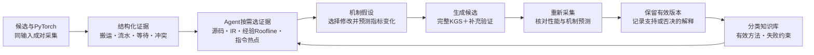

# Ascend 910B：HG-KDA方法进展与算子闭环

本期将“成对比较找差异、源码与热点查机制、分类知识选方法、完整评测验效果”连接成可运行的HG-KDA工作流，并用矩阵乘完成一次从新采集到预测复核的演示。

累计算子结果统一维护在[Kernel Table](https://www.yuque.com/up3wk0/twwy86/vcqrbcy2hp7gds4g)，覆盖21个优化算子；本篇聚焦方法、本期新增交付与一个完整案例。

## 一、本期方法进展

在老师提供的成对profiling工作流基础上，完成910B适配和KG／KGS接入，并增加以下能力：

| 环节 | 方法与新增能力 | 具体例子 |
| --- | --- | --- |
| 成对性能分析 | 同输入采集候选与PyTorch，脚本按Cube／Vector整理搬运量、指令数、流水时间、等待和冲突，计算均值、极值、总数、指标比值与平均搬运粒度 | `log10_`某大输入读取量相近，候选MTE2为2036条、参考760条，平均搬运约16.5 KB／44.2 KB；优先检查搬运组织 |
| 源码与编译机制定位 | 将源码、实际TTIR／bcmlir、实测指标、同精度经验Roofline参考和候选kernel指令热点组织成结构化证据，供Agent按需读取 | 矩阵乘候选的UB读写与搬运指令发生变化，而GM总量基本不变；把诊断从“少搬数据”推进到“片内组织是否改善” |
| 分类知识与工具选择 | 按“算子类型＋性能指标”保存成功方法、失败经验和约束；Agent先选择证据工具，再选择修改方向 | `selu_`：小输入查启动、大输入查分块；扩大分块前检查UB，FP16配置不能直接套用到BF16／FP32 |
| 评测与反馈 | KGS完整合同之外，增加布局、特殊值、别名、随机状态、stream与计时输入数值检查；复采证据核对预测，记录采纳或否决原因 | `upsample_bilinear2d`修复分块交界重复写，24/24正式＋84项补充通过；`uniform`排除未通过标准Philox的旧高分 |

脚本负责可重复的聚合、差异计算、热点筛选与校验；Agent结合证据、源码和知识提出待验证的机制假设。原始指令清单和debug源码映射由KGS／厂商工具提供，我们增加目标kernel匹配、无关任务过滤与热点排序。

经验阈值如搬运或Vector活跃比例≥0.7、Scalar活跃比例≥0.5用于提示检查方向，不直接等于峰值利用率或证明瓶颈。验证后的经验经核验入库，目前不把模型总结自动写成事实。

### 当前工作流

当前统一演示入口由Python控制器串联，模型在受限工具集合中选择要读的证据；已有HG-KDA扩展分析角色可接入KG，评测仍使用KGS。成对采集基于导师方法；指标脚本、热点筛选、分类知识、补充验证及统一衔接构成本项目增量。尚未完成新版KG原生工具接口的全量迁移。

## 二、完整案例：matmul_bias_activation

算子计算`ReLU(A×B+bias)`。本次使用已有优化源码起步，验证“新采集→Agent选工具→候选变换→完整评测→预测复核”。

### 1. 自动对比与形成假设

对同seed、shape和dtype的候选／PyTorch采集真机指标，Agent主动读取源码、实际IR、成对指标、指令热点与知识，选择“相邻输出块共享B”和“交错加载”两种动作。

以FP16方阵为例：

| 输入规模 | 起点融合kernel | PyTorch GEMM组件 |
| --- | --- | --- |
| 512³ | 13.700 μs | 7.060 μs |
| 1024³ | 36.161 μs | 16.200 μs |

这两行用于观察GEMM组件与融合实现的硬件差异；PyTorch列只包含GEMM组件、候选包含bias／ReLU，**不能将二者直接相除当作完整算子加速比**。

开发集先选定共享B方案，再冻结候选并做正式评测；模板与控制器由Codex实现，模型负责证据选择与动作决策。

### 2. 热点指令与源码位置

通过KGS读取模拟器指令清单，再由HG-KDA限定候选kernel并筛选热点。起点共1087条指令，983条有源码映射，示例如下：

| 单核指令观测 | 时间 | 对应源码位置 |
| --- | --- | --- |
| `MOV_OUT_TO_L1_MULTI_ND2NZ` | 4.520 μs | 第454行：`b1_ptrs = b0_ptrs + BLOCK_SIZE_N * stride_bn` |
| `WAIT_FLAG_DEVI` | 5.290 μs | 第473行：`v0 = acc0 + bias0[None, :]` |
| `BAR` | 1.610 μs | 第475行：`v0 = tl.maximum(v0, v0 * 0.0)` |

模拟器导出后子进程异常退出，本批按**部分指令证据**记录；这些时间不能当真机正式延迟、不能相加重建关键路径。源码映射表示debug来源位置，具体因果仍需结合IR和实验确认。

### 3. 完整验收并复采核对预测

| 版本 | 相对PyTorch设备加速比 | 完整KGS | 补充检查 |
| --- | --- | --- | --- |
| 本批历史优化起点 | 0.865× | 42/42 | 18＋24项通过 |
| 本批共享B候选 | **0.884×** | 42/42 | 18＋24项通过 |

15项相同case的实际设备延迟比几何平均为 **1.023×**。候选与此前成功源码同字节：本次结果证明已有分析经验可被统一工作流复现，不计为新发现，也不与历史0.909×跨批次择高或平均。

重新采集后：

| 核对项 | 候选／起点 | 说明 |
| --- | --- | --- |
| GM／L2／L1总字节 | 基本不变 | 不支持“减少外部总搬运”的原预测 |
| UB读写总量 | 0.831× | 片内读写下降约16.9% |
| Vector读UB | 0.727× | Vector侧UB读取减少 |
| AIV MTE2指令数 | 0.818× | 搬运指令减少 |
| 平均每条搬运字节 | 1.217× | 平均搬运粒度增大 |
| bcmlir静态copy／alloc | 各5处→4处 | 编译后的搬运／缓冲组织变化 |

**案例要点：** 不仅检验“代码有没有更快”，还检验“原先提出的机制解释是否成立”。本例支持片内搬运与尾处理组织改善，但模型预测的“B侧总搬运下降、等待消除”未得到完整支持，应修正解释。

同环境实测校准的数值Roofline参考已接入本例，用于衡量与经验参考线的距离；尚不等于经核实的物理峰值或完整的component-based Roofline。

## 三、本期新增算子交付与诊断

会议指定10项目前为 **7项默认条件达标、1项确定性条件达标、2项补充NPU对照**。SGLang的`gelu_and_mul`、`moe_sum_reduce`沿用已交付结果。各算子的Excel原记录、FlagGems实测、日期、HG-KDA及测试项数统一见[Kernel Table](https://www.yuque.com/up3wk0/twwy86/vcqrbcy2hp7gds4g)。

| 本期重点 | 结果 | 新增优化／诊断 |
| --- | --- | --- |
| `scatter_add` | **1.900×**，18/18正式及扩展数值检查 | 显式分段扫描替代整行前缀相减，避免不同目标间大数吞掉小结果；旧1.306×反例版本排除 |
| `upsample_bilinear2d` | **0.915×**，24/24＋84项补充 | 连续输入行分块，一次算两行；修复交界重复写入；较同批父版实际加速2.559× |
| `cumulative_trapezoid` | **0.812×，仅确定性条件**，33/33 | Triton融合前处理＋CANN扫描；默认参考同输入重复结果不自洽，官方确定性条件下通过 |
| `fractional_max_pool3d` | **10.066×，补充NPU分解对照** | 连续128输出分块，较同批父版实际加速1.547×；保留低精度窗口舍入和索引语义 |
| `_conj_physical` | **2.296×，补充NPU分解对照** | 保留已有Triton实现；DMA新候选未更快，补齐参考执行路径与布局验证 |

此表除矩阵乘独立案例外，均为KGS完整调用walltime。池化、共轭的官方参考包含CPU回退，因此补做自建NPU多原语分解对照；这些分数不等同于相对官方原生单kernel的加速。累计积分不计入默认条件达标。

## 四、复现、归属与证据

- 固定FlagGems：`d6a8eec473517a3d68157b208eb9c057eb1d4c50`；FlagGems-SGLang：`938612058a981487e439da514df7d1371cf31e68`；FlagTree：`0.6.0+ascend.gitc286cba6`；CANN 9.0。
- HG-KDA当前由项目内skill／分类知识、Python／Bash脚本与模型调用组成；KG、CC／DeepSeek与Codex的生成、分析和修复按实际记录区分。
- 10-26三项收尾的96项证据核验通过，相关提交已完成三端同步。10-27矩阵乘演示Windows与910B各3826项证据核验通过，3432个文件同步完成；该演示尚未推送GitHub。
- 矩阵乘演示源码、实际模型调用、指标、IR、热点、完整评测、预测复核均位于`operators/campaigns/agent-demo-20261027/`，说明与入口为`tools/profiling/hgkda/agent_demo/README.md`。原始失败及未采纳候选继续保留。

[算子成果总表](https://www.yuque.com/up3wk0/twwy86/vcqrbcy2hp7gds4g) · [20261015历史报告](https://www.yuque.com/up3wk0/twwy86/hg51glsd1pcswwc5) · [已提交的会议10项验收证据](https://github.com/LeleCheung/Ascend-Optimization/blob/main/project/Ascend-Optimization-v1/operators/会议10算子最终验收-20261026.md)

## 附：rad2deg_热点筛选的补充例子

原报告中的`rad2deg_`清单有92条指令，72条带源码映射。保留以下例子，展示热点筛选输出：

| 指令 | 模拟器报告时间 | 对应位置／含义 |
| --- | --- | --- |
| `BAR` | 25.61 μs | 流水同步屏障 |
| `WAIT_FLAG` | 17.03 μs | 映射至`tl.store(x_ptr + off, y)`相关位置，提示检查写回等待 |
| `MOV_SRC_TO_DST_ALIGN` | 8.57 μs | 同样映射至`tl.store`相关位置的搬运 |

原始清单与映射由KGS／厂商工具生成，项目的`hgkda_adapter.py::instruction_hotspots`负责候选kernel匹配与筛选。时间可能重叠，源码位置不是独占因果；模型据此提出需要继续验证的写回／同步假设。

