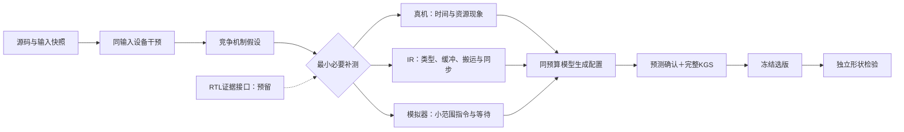

# HG-KDA设备机制系统闭环

本轮把设备干预、竞争机制假设、分层补测和受约束模型配置接入同一流程，检验矩阵乘与归约两类设备机制。父版是历史KG/HG-KDA、CC/DeepSeek与Codex共同优化源码；矩阵乘新增两组共享的布局及小K兼容修复。以下相对父版收益不等于相对原版FlagGems。

## 一、结果

| 算子 | 组别 | 开发集完整调用：相对父版 | 独立集完整调用：相对父版 | 开发集设备kernel：相对父版 |
|---|---|---:|---:|---:|
| `amin` | 原始证据模型组 | 0.910× | 1.141× | 1.119× |
| `amin` | 机制诊断模型组 | 1.044× | 1.113× | 1.142× |
| `matmul_bias_activation` | 原始证据模型组 | 1.100× | 1.000× | 0.898× |
| `matmul_bias_activation` | 机制诊断模型组 | 1.067× | 0.976× | 0.889× |

每个Native合同包含18项正确性与6项性能。相对父版由同case实际延迟相除后取几何平均；完整调用包含host与device。设备列来自4个开发输入、各5轮同输入配对，排除host发射间隙；独立集只检验完整调用，没有将开发设备收益冒充独立设备收益。

### 设备确认逐形状

| 算子 | 组别 | 形状 | 类型 | 相对父版设备kernel |
|---|---|---|---|---:|
| `amin` | 原始证据模型组 | [4096, 4096] | float16 | 1.348× |
| `amin` | 原始证据模型组 | [4096, 4096] | float32 | 1.154× |
| `amin` | 原始证据模型组 | [64, 512, 512] | float16 | 0.990× |
| `amin` | 原始证据模型组 | [64, 512, 512] | float32 | 1.018× |
| `amin` | 机制诊断模型组 | [4096, 4096] | float16 | 1.469× |
| `amin` | 机制诊断模型组 | [4096, 4096] | float32 | 1.160× |
| `amin` | 机制诊断模型组 | [64, 512, 512] | float16 | 0.992× |
| `amin` | 机制诊断模型组 | [64, 512, 512] | float32 | 1.005× |
| `matmul_bias_activation` | 原始证据模型组 | [256, 256, 256] | float16 | 0.890× |
| `matmul_bias_activation` | 原始证据模型组 | [256, 256, 256] | float32 | 0.830× |
| `matmul_bias_activation` | 原始证据模型组 | [1024, 1024, 1024] | float16 | 0.879× |
| `matmul_bias_activation` | 原始证据模型组 | [1024, 1024, 1024] | float32 | 1.003× |
| `matmul_bias_activation` | 机制诊断模型组 | [256, 256, 256] | float16 | 1.105× |
| `matmul_bias_activation` | 机制诊断模型组 | [256, 256, 256] | float32 | 1.202× |
| `matmul_bias_activation` | 机制诊断模型组 | [1024, 1024, 1024] | float16 | 0.572× |
| `matmul_bias_activation` | 机制诊断模型组 | [1024, 1024, 1024] | float32 | 0.821× |

### 原项目FlagGems合同：设备计时

| 算子 | 版本 | 状态 | 完整项数 | 相对PyTorch设备计时 | 相对本批父版设备计时 |
|---|---|---|---:|---:|---:|
| `amin` | 历史优化父版＋共享适配 | passed | 27 | 1.419× | 1.000× |
| `amin` | 原始证据模型组 | passed | 27 | 1.517× | 1.081× |
| `amin` | 机制诊断模型组 | passed | 27 | 1.509× | 1.083× |
| `matmul_bias_activation` | 历史优化父版＋共享适配 | passed | 42 | 0.862× | 1.000× |
| `matmul_bias_activation` | 原始证据模型组 | passed | 42 | 0.780× | 0.903× |
| `matmul_bias_activation` | 机制诊断模型组 | passed | 42 | 0.643× | 0.749× |

原合同使用FlagGems默认KERNEL模式，其do_bench_npu通过MSPTI或torch_npu.profiler记录设备任务。evaluate-operator.py的--timing-scope只记录标签，不改变benchmark；本批原合同provenance误记walltime，原字节保留，这里根据timing-scope-evidence更正为device_kernel。Native完整调用与该表不混用。原合同失败保留错误，不用局部通过性能代替完整结果。

## 二、方法和证据



Codex实现干预空间、测量器、竞争假设、补测规则、模板与兼容修复；CC＋DeepSeek选择配置并输出预测。两组均看到相同原始干预、实际IR摘要和新增采集；机制组额外得到结构化诊断。每组每算子两次候选机会，最多一次格式修正，失败占用机会。它是有限空间配置生成实验，不是模型自由合成任意kernel的对照，也不是纯原生KG对照。

| 算子 | 采集 | 真机/KGS终态 | OpProf kernel数 | 模拟器core数 | 时间（秒） |
|---|---|---|---:|---:|---:|
| `amin` | parent-metrics | completed | 0 | 0 | 32.1 |
| `amin` | parent-instruction | failed | 1 | 0 | 214.5 |
| `amin` | winner-metrics | completed | 0 | 0 | 29.1 |
| `matmul_bias_activation` | parent-metrics | completed | 0 | 0 | 29.1 |
| `matmul_bias_activation` | parent-instruction | failed | 1 | 0 | 216.6 |
| `matmul_bias_activation` | winner-metrics | completed | 0 | 0 | 31.2 |

### `amin`

补测选择：`instruction`。有效干预仍对应多种设备解释，采用小case指令与等待补测。

干预方向按相同调度重表达对照比较；变化超过测量范围且最坏收益>5%才标为待确认方向。最终候选再次与父版配对。

- case 0／`more_rows`：一次归约更多行，检查program数、归约指令与缓冲。
- case 1／`more_rows`：一次归约更多行，检查program数、归约指令与缓冲。

机制组胜出配置：`{"bo": 16, "last_br": 512, "bc": 512, "middle_br": 16, "native": true, "multi": true}`。

模型假设：amin的2D末轴路径是MTE2访存受限：父版intervention（case 0/1）显示aiv_mte2_ratio≈0.86，标量等待MTE2的时间占比很高。把BO从8提到16、last_br从1024降到512后，每个program的连续行块仍保持8192元素（16×512），片上缓冲占用不变，但program数从512减到256，每个program内的行维更宽，从而摊薄循环与同步开销，并提高MTE2搬运效率。父版干预证据中more_rows在FP16 4096²上为1.38×，在FP32 4096²上为1.15×，方向明确。3D中间轴路径上（case 2/3），父版因last_br与BC都取512而不触发mask，且BC=512正好整除I=512，所以非整除边界不受影响，只是走同一共享兼容路径。对FP32（case 2为FP16），native仅对FP16生效，BF16/FP32仍用FP32中间值，数学不变。。

模型预测原文：`[{"case": "0", "spec": "4096x4096 fp16 dim=1", "metric": "paired_speedup_vs_parent", "baseline_ms_approx": 0.0219, "expected_delta": "1.30~1.40x", "expected_range": [1.25, 1.45]}, {"case": "1", "spec": "4096x4096 fp32 dim=1", "metric": "paired_speedup_vs_parent", "baseline_ms_approx": 0.0261, "expected_delta": "1.10~1.18x", "expected_range": [1.05, 1.2]}, {"case": "2", "spec": "64x512x512 fp16 dim=1", "metric": "paired_speedup_vs_parent", "baseline_ms_approx": 0.0124, "expected_delta": "≈1.00x", "expected_range": [0.96, 1.04]}, {"case": "3", "spec": "64x512x512 fp32 dim=1", "metric": "paired_speedup_vs_parent", "baseline_ms_approx": 0.0214, "expected_delta": "≈1.00x", "expected_range": [0.96, 1.03]}, {"case": "0/1", "metric": "aiv_mte2_ratio", "baseline_approx": 0.855, "expected_delta": "↓，单program搬运更长、同步更少"}, {"metric": "max_abs_error", "expected": "0.0（所有case）"}, {"metric": "masked_flag", "expected": "2D两端false（4096%16==0, 4096%512==0）；3D两端false（512%512==0, 512%16==0，FP16时BR=32）"}, {"metric": "geomean_speedup_over_4_cases", "expected_range": [1.08, 1.2]}]`。

### `matmul_bias_activation`

补测选择：`instruction`。有效干预仍对应多种设备解释，采用小case指令与等待补测。

干预方向按相同调度重表达对照比较；变化超过测量范围且最坏收益>5%才标为待确认方向。最终候选再次与父版配对。

没有干预达到预设的明确方向门槛；仍保留原始测量与失败。

机制组胜出配置：`{"bm": 128, "bn": 64, "bk32": 128, "bk16": 128, "group": 8, "multi": true}`。

模型假设：开发集上只有 group4 相对重表达对照是正收益（FP16 1.018×、FP32 1.001×，几何均值 1.009×），说明分组调度改善 L2 复用是被支持的方向。对照中 Cube 活跃仅约 15%，Cube 等待比例 0.29 且主要卡在 aic_scalar_mte1_stall，即时间耗在每次 K 迭代搬入的面板数据等待上，而非累加吞吐。本配置在保持 BM=128、K=1024 整除（bk16=128 为 8 个 BK、bk32=128 为 8 个 BK，满足 K>=2*BK）的前提下，把 BN 由 128 收到 64：单个累加器由 128×128 降为 128×64，双累加器共用的 UB/L0 缓冲减半，从而让 multi 双缓冲真正重叠 MTE2 搬运与 Cube 计算，针对 scalar_mte1_stall 这一主要等待源；同时把 BN 减半带来的 A 重复请求用更大的 group=8 蛇形分块来抵消，保持 L2 局部性。历史 compact_n 的失败是 BN=64 且 group=0 时 A 请求翻倍、复用为零，因此本候选必须与 group=8 一起验证，不能把它单独当作 tile 缩减的结论。若缓冲压力不是主因，预期收益不会超过 group4 的场景。。

模型预测原文：`[{"metric": "paired_speedup_vs_parent_fp16_1024", "baseline": 1.0, "expected_change": "+1% 至 +3%（相对父版的配对加速比）", "rationale": "group=8 继承 group4 的复用正效应；BN=64 若缓解搬运等待则进一步放大"}, {"metric": "paired_speedup_vs_parent_fp32_1024", "baseline": 1.0, "expected_change": "0% 至 +2%", "rationale": "FP32 中间值仍为 FP32，累加器减半带来的缓冲收益大于 FP16，但 group4 在 FP32 上仅 1.001×，上限有限"}, {"metric": "aic_scalar_mte1_stall_time_us", "baseline": 7.21, "expected_change": "-15% 至 -30%", "rationale": "缓冲占用减半后双缓冲可以掩盖更多 A/B 面板搬运，scalar 不再长期等待 MTE1"}, {"metric": "cube_utilization_pct", "baseline": 14.39, "expected_change": "+2 至 +5 个百分点", "rationale": "等待缩短意味着 Cube 空闲间隙收窄，总量不变所以利用率上升幅度有限"}, {"metric": "requested_B_bytes", "baseline": 16777216, "expected_change": "不变（n//(2*bn) 仍为 8，程序数仍 32）", "rationale": "n/(2*bn) 与父版相同，B 的逻辑请求量不增加；A 逻辑请求也不变"}, {"metric": "max_abs_error", "baseline_16": 0.125, "baseline_32": 0.00012969970703125, "expected_change": "保持不变", "rationale": "只改分块和调度，K 迭代顺序不变，累加顺序不变，数学计算不改变"}, {"metric": "compile_status", "baseline": "passed", "expected_change": "passed（cbuf 余量与父版相同，降低 BN 只会减小缓冲需求）", "rationale": "父版 shared_mem_dynamic_size=221184 已在预算内，BN 减半不会引入超限"}]`。

OpProf流水活跃比例可以重叠，不能加和成时间分解。静态IR匹配不是动态指令计数，逻辑请求量不等于实测HBM流量。编译metadata中的shared/workspace字段不直接当作UB独占峰值。模拟器只有成功返回匹配目标kernel的指令附件才算采集成功；失败和超时单列。本轮尚无定量Roofline、完整指令依赖图或RTL执行器。

## 三、成本与失败

| 算子 | 组别 | 候选 | 状态 | 总时间（秒） |
|---|---|---:|---|---:|
| `amin` | 机制诊断模型组 | 1 | passed | 299.2 |
| `amin` | 机制诊断模型组 | 2 | passed | 318.6 |
| `amin` | 原始证据模型组 | 1 | passed | 278.0 |
| `amin` | 原始证据模型组 | 2 | failed | 37.5 |

失败：`RuntimeError: 步骤失败，见 /data/hanle/ascend-optimization/runs/device-night-20261026-v11/device-check-amin-raw_evidence-2.log`。

| `matmul_bias_activation` | 原始证据模型组 | 1 | passed | 247.3 |
| `matmul_bias_activation` | 原始证据模型组 | 2 | failed | 48.5 |

失败：`RuntimeError: 步骤失败，见 /data/hanle/ascend-optimization/runs/device-night-20261026-v11/device-check-matmul_bias_activation-raw_evidence-2.log`。

| `matmul_bias_activation` | 机制诊断模型组 | 1 | passed | 260.8 |
| `matmul_bias_activation` | 机制诊断模型组 | 2 | failed | 39.3 |

失败：`RuntimeError: 步骤失败，见 /data/hanle/ascend-optimization/runs/device-night-20261026-v11/device-check-matmul_bias_activation-mechanism-2.log`。


前置失败批次device-night-20261026至v7完整保留：ABI、历史小K流水超时、采集文件遮蔽stdlib、精度合同、带步长UB溢出与Definition可选参数问题。v8起点修复属于系统建立成本，不从总投入中删除。超时kernel日志只能定位失败路径，尚不能证明精确的硬件死锁原因。

## 四、核验与复现

方法/源码/模型/评测核验213项；附件及CSV核验976项，覆盖506份唯一附件和202次设备配对采集。完整原件在批次raw-evidence归档。

方法在system-snapshot/冻结；selection-frozen.json先于独立集评测写入。源码、配置、提示词、模型回执和失败均随批次保留。独立集固定开发外形状，未根据其结果继续调参；这仍是两个算子的形状迁移检验，尚不构成跨算子或跨芯片泛化结论。

在910B宿主运行以下命令，可在新目录完整复现冻结交付，不重新调用模型：

```bash
cd /data/hanle/ascend-optimization/Ascend-Optimization/project/Ascend-Optimization-v1
/data/hanle/ascend-optimization/runtime/kg-controller/venv/bin/python3 \
  tools/profiling/hgkda/device_mechanism/reproduce.py --batch device-night-20261026-v11 \
  --operator amin --arm mechanism --split heldout \
  --output /data/hanle/ascend-optimization/runs/device-mechanism-reproduction-新目录
```

使用项目物理卡7互斥锁及既有KGS19659；替换operator可复现矩阵乘。复现脚本做18项语义检查、开发设备确认及指定合同的一次完整评测。本轮未执行额外重复的正式复测，也未提交或推送GitHub。

## 五、共享成本与版本修复

本批共享准备、父版语义、完整起点和干预阶段耗时1010.1秒；冻结方法后的生成、评测、采集与独立检验阶段耗时4140.1秒。这些阶段成本不能只用模型推理时间代替；模型usage与时长保留于结果JSON的generation字段。

v8两个归约候选均在NaN补充检查中为9/18，未交付。固定Triton的minimum与min默认忽略NaN；本批两组共享显式NaN传播minimum和reduce组合器。显式reduce同时去掉标准tl.min对低精度输入的隐式扩展，这些共享修复不计为模型配置搜索收益。v9/v10新增预检暴露工具导入冲突，均在算子提交前停止，原回执保留。

本批父版先通过18项补充语义再进入完整评测；候选语义不通过则不继续设备采集。中间轴FP16原生实际BR为配置middle_br两倍，FP32/BF16为配置值；默认组织与父版实际参数对齐。模型输入包含最终wrapper模板、编译绑定常量、历史失败的具体语义用例及设备确认，避免只根据父版代码猜测候选路径。

统一层级证据由evidence_layers.py在采集后只读导出，不参与本批冻结的诊断或选版。RTL条目固定为not_run并列出适配器所需设计版本、时钟、存储模型、激励和波形身份；没有RTL运行成果。

## 六、代码机制的直接核验

以下按实际捕获的编译常量和grid核对配置，程序数是Triton逻辑program数；两份捕获路径均只有一次kernel提交。program数减少不等于kernel launch次数减少。

| amin类型 | BO | BR | grid中的program数 | 每个program归约循环次数 | 设备确认 |
|---|---|---|---|---|---:|
| float16 | 8→16 | 1024→512 | 512→256 | 4→8 | 1.469× |
| float32 | 8→16 | 1024→512 | 512→256 | 4→8 | 1.160× |

输入元素总数不变；该配置同时改变每个program处理的行数、循环次数和末次横向归约跨度，因此已确认的是整体归约组织的设备收益。仅凭这一组联动变换，不能把全部收益唯一归因于program调度或MTE2。

### 成对资源计数的输入核对

- `amin`：父版`amin-development-timing-5`，候选`amin-development-timing-3`；case不同，不相除或推断计数变化。
- `matmul_bias_activation`：父版`matmul_bias_activation-development-timing-4`，候选`matmul_bias_activation-development-timing-1`；case不同，不相除或推断计数变化。

模型关于MTE2、带宽或等待的原文是待验证假设。设备资源指标属于所绑定的case；3D最慢case的计数不能代替2D归约的资源证据，逐block计数也不能直接当作全卡HBM峰值利用率。本轮用实际grid、IR、设备配对和完整评测核验了代码变更与性能效应；未建立设备完整因果依赖图。
