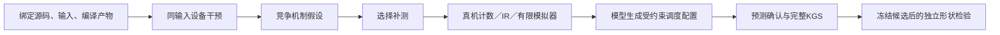

# 设备机制闭环：矩阵乘与归约

本模块将HG-KDA从调用分派机制扩展到设备分块、缓冲、搬运粒度与归约组织。父版使用历史优化源码，Codex实现通用变换与策略，CC＋DeepSeek选择配置；成果不称为纯原生KG自动发现。

## 实现

- `prepare.py` 预登记开发与独立合同、父源码身份和配置空间。两组共享相同的必要兼容修复，旧失败批次不覆盖。
- `variants.py` 保留父数学内核，通过通用模板改变矩阵分块／分组／多缓冲、归约分块／FP16中间精度。边界mask按整除条件保留，未知布局回父路径。
- `probe.py` 捕获固定输入的Triton提交，交错测量设备kernel延迟，保存实际编译IR和配置失败。这里不测完整调用walltime。
- `diagnose.py` 比较受控干预，提出可验证假设。变体间比较需进一步配对确认，未将流水活跃比例直接解释为瓶颈原因。
- `collect_profile.py` 在KGS完整通过后采集真机和模拟器证据，绑定操作ID。只允许取消本次登记的请求；模拟器core0、2分钟，整项最多300秒。保留缺失、失败和超时，不重启共享服务。
- `check.py` 检查布局、keepdim、新指针、stream、输入不变性及归约特殊值，另用开发集同输入设备计时核验候选预测。矩阵乘数值合同为有限随机输入。
- `run.py` 在宿主tmux持卡锁连续执行；模型两组共用相同配置空间、起点、测量和两次候选预算。方法组额外获得机制诊断，配置由同一模板生成源码。独立集在选版冻结后运行，不用于调参。

真机数据用于确认效应和资源现象，IR用于关联编译机制，模拟器用于小范围指令／等待补测；三者不互相冒充。RTL暂只有统一证据接口中的预留层级，没有RTL执行器。当前没有设备关键路径重建或定量Roofline。

## 批次

当前开发批次为 `operators/campaigns/device-night-20261026-v5`。首批参考ABI不匹配，v2历史矩阵父版的pipeline路径在新形状上发生aicore超时；后续对单K迭代共享关闭多缓冲/unit_flag。v3采集文件名遮蔽stdlib profile，在导入torch时即失败；v4探针错误地统一使用1e-4相对容差，父版FP16出现11/1048576不匹配。v5对齐固定FlagGems测试精度：atol=1e-4×K，rtol为FP16 1e-3、BF16 0.016、FP32 1.3e-6，逐元素全部匹配；原失败保留。真实进展以 `stage-state.json`、`state.json`、冻结文件和评测回执为准，启动队列不代表完成。

设备使用物理卡7、容器`tle_yy`、KGS19659与项目互斥锁。工作环境和源码树不修改共享镜像，不影响他人服务。
