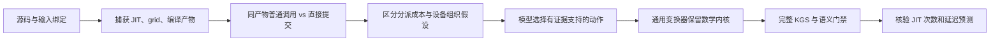

# HG-KDA 机制闭环原型：从观察瓶颈到验证改法

本轮交付了一种可复现的单机制优化流程：**捕获真实调用 → 定向干预区分原因 → 选择受约束变换 → 完整评测 → 核验预测变化**。同一份通用变换器在开发算子 `selu_` 和冻结后的独立算子 `asinh_` 上生效，数学内核保持原样。

## 本轮结果

以下从固定 FlagGems 数学源码＋两组共享正确性适配出发。相对 FlagGems 的列逐case计算“本批起点实际延迟÷候选实际延迟”后取几何平均；不是两组相对PyTorch分数相除。采用 KGS 批量调用前后同步的完整调用 walltime，一次正式评测。

| 算子 | 用途 | 方法 | 相对本批FlagGems＋共享适配 | 相对PyTorch | 完整KGS＋补充检查 |
|---|---|---|---:|---:|---:|
| `selu_` | 开发 | 原始证据自由生成 | 0.755× | 0.083× | 51/51＋21/21 |
| `selu_` | 开发 | 机制诊断＋受约束变换 | 1.457× | 0.151× | 51/51＋21/21 |
| `asinh_` | 冻结后独立检验 | 原始证据自由生成 | 0.882× | 0.149× | 51/51＋21/21 |
| `asinh_` | 冻结后独立检验 | 机制诊断＋受约束变换 | 1.448× | 0.245× | 51/51＋21/21 |

这些成绩验证调用机制改写，不替换历史优化版，也不表示新算子已超过0.8×验收线。共享适配保留原数学计算，对非连续布局执行连续临时量后回写，独立批次另显式处理空输入；两组起点完全相同。逐case延迟、参考漂移和源码身份见同名CSV。

## 已实现的机制闭环

1. **绑定证据。** 保存输入形状、dtype、设备、源文件SHA、运行时SHA、编译产物摘要和实际grid。调用图只表示wrapper→JIT→runtime提交→设备→完成的语义链。
2. **区分原因。** 在同输入、同编译对象和grid上交错比较普通调用与直接提交。所有配对比例大于1.15时支持分派假设；具备明确长度与分块接口时，再用相同JIT入口改变block/grid。1.15与1.10是预登记经验门槛，非统计置信度。
3. **编译动作。** CC＋DeepSeek选择缓存分派或保留；通用Python模板缓存编译对象和参数模板，逐次重新绑定当前输入、指针和stream。模板没有算子数学公式，首调用执行一次后直接返回，未知布局回原实现。
4. **验证预测。** 不仅检查数值和速度，还核对暖态JIT分派是否减少。当前交付只应用分派变换，未同时改变数学内核和设备分块。

| 算子 | FP32元素数 | 暖态JIT调用数 | 同输入中位延迟，微秒 | 配对加速比中位数 |
|---|---:|---:|---:|---:|
| `selu_` | 1024 | 1→0 | 96.76→69.37 | 1.404× |
| `selu_` | 1048576 | 1→0 | 95.30→69.24 | 1.370× |
| `asinh_` | 1537 | 1→0 | 96.79→69.30 | 1.402× |
| `asinh_` | 1572864 | 1→0 | 98.06→71.87 | 1.368× |

上述延迟为9组交错观测的同步walltime，包含调用与设备执行；不是单个流水的独占时间。补充检查覆盖三种dtype、特殊值、空输入、偏移、stride、新地址与两个stream，正式合同另有42项正确性和9项性能。原始trace保存于各批次归档；采集出现level0不含aic metrics及schedule警告，不能据此声称本轮已得到PipeUtilization或指令级因果图。

## 冻结后独立检验与对照

开发阶段使用SELU；先冻结规则、探针、检查器和变换器，再执行独立算子及不同形状。`asinh_` 按明确的一维JIT接口选择，选择时查看了接口源码，没有加入其专用公式改写或专用优化建议；不是按测得加速比挑选。两批上述四个核心文件SHA一致，变换器为 `ad9406ce8e7b14f523d10719d4920c87a0ba007cb6277968245e8697a0b592da`。

原始证据组与机制组共享起点、接口知识、模型、原始探针和正式合同，各一次候选机会，最多一次格式修正；开发算子先自由生成，独立算子先受约束变换。前者自由输出完整源码，后者输出动作JSON再由模板改写。因此本轮比较的是“机制诊断＋受约束变换”的组合效果，不能单独归因执行图，也不是纯原生KG组。一次候选检验用于证明可运行和迁移，不给出统计显著结论。

Codex实现并审查工具、制定合同与接口知识、编排实验和核验证据；CC＋DeepSeek完成自由源码生成或动作选择。最终受约束候选可从起点和冻结模板逐字节重建，没有手改已生成候选。

## 失败与适用范围

| 对象或批次 | 真实结果 | 处理 |
|---|---|---|
| 首次pilot | 公共别名冲突，0/51，未调用模型 | 独立新版本修正ABI，原证据保留 |
| pilot-v2机制自由生成 | 首次正常调用后又提交一次，补充仅9/21 | 拒绝正式计分；新增通用变换器，未手修失败候选 |
| sigmoid_独立尝试 | 原起点48/51，二维非连续布局错误 | 停在起点评测；后续共享布局适配单独登记 |
| tanh_独立尝试 | 起点51/51，暖态探针0/4捕获JIT | 保留unsupported，不生成候选；另设asinh_批次 |
| compiler初稿 | 预审发现拟修改全局JIT类 | 未执行；最终只临时代理候选自身JIT实例并恢复 |

本轮最重要的系统进展是：**机制假设带有可执行探针，代码改写带有前提和不变量，结果同时验证性能与预期路径变化。** 当前调用图尚没有设备指令依赖、资源占用时间轴或定量Roofline；也未实现硅前模拟器／RTL与真机的统一重放。向论文系统推进应复用同一证据接口，增加设备机制、未见算子集和受控比较，而不是仅增加算子分数。

## 成本与证据

| 算子 | 方法 | 输入token | 输出token | 模型秒数 | 生成至完整评测秒数 |
|---|---|---:|---:|---:|---:|
| `selu_` | 原始证据自由生成 | 5719 | 1885 | 8.63 | 190.58 |
| `selu_` | 机制诊断＋受约束变换 | 10774 | 265 | 2.49 | 174.37 |
| `asinh_` | 原始证据自由生成 | 5920 | 1274 | 5.62 | 187.40 |
| `asinh_` | 机制诊断＋受约束变换 | 10843 | 164 | 1.94 | 184.75 |

两组同候选上限，不等同实际墙钟相等；探针成本另存 `seed-probe/cost.json`，起点评测时间和进程启动记录在host日志中。未获得可信计费金额，不以token估造费用。两批证据核验共 **307项通过**；早期pilot-v2另有134项身份核验通过，不将其失败候选计为成功。

## 文件与复现

- [开发批次](campaigns/mechanism-compiler-20261026-v2/README.md)：完整对照、tanh_接口失败与158项核验。
- [独立检验](campaigns/mechanism-heldout-asinh-20261026/README.md)：独立算子两组、冻结身份和原始证据。
- [机制模块](../tools/profiling/hgkda/mechanism/README.md)：探针、规则、调用关系与命令。
- `tools/profiling/hgkda/reproduce-mechanism.py`：无模型重跑交付源码，使用新目录、卡锁、21项门禁和一次完整KGS；该入口做过语法检查，未为检查入口再重复正式测试。
- `tools/profiling/hgkda/audit-mechanism.py`：离线核验来源、合同、冻结模板重建、预测及原始归档。
- `tools/profiling/hgkda/report-mechanism.py`：从已核验批次重新生成本报告与CSV；须指定新输出，避免覆盖旧报告。

环境固定为910B物理卡7、容器 `tle_yy`、KGS19659；FlagGems提交 `d6a8eec473517a3d68157b208eb9c057eb1d4c50`，FlagTree `c286cba6d5c30f07988c0414beb21fd2be1abb3e`，锁定记录见仓库 `manifests/hgkda-stage2.lock.json`。快路径使用固定后端私有启动ABI，升级须重新验证。Windows长路径profiler保留在 `raw-evidence/remote-files.tar.gz`，不是Git LFS指针；索引记录每个成员SHA。未修改共享镜像、其他服务或他人进程。本轮文件待用户后续授权提交GitHub。
