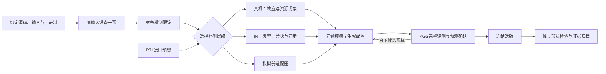

# HG-KDA设备机制闭环：归约与矩阵乘

本轮完成了“设备干预 → 竞争假设 → 真机／IR／有限模拟器补测 → 模型配置 → 完整KGS → 冻结后独立形状检验”的连续流程。**amin取得新设备收益；矩阵乘候选变慢，保留本批父版。**

父版来自历史KG/HG-KDA、CC/DeepSeek与Codex参与的优化源码，另加两组共享的正确性和兼容修复，不是原版FlagGems。依赖固定为FlagGems `d6a8eec473517a3d68157b208eb9c057eb1d4c50`、FlagTree `0.6.0+ascend.gitc286cba6`、CANN 9.0.0、KGS 6.5.0，使用910B物理卡7。

## 可以汇报的结果

原项目FlagGems合同，**相对PyTorch的设备计时加速比**：

| 算子 | 本批父版 | 原始证据模型组 | 机制诊断模型组 | 机制组相对父版 | 各版本完整评测 |
|---|---:|---:|---:|---:|---|
| `amin` | 1.419× | 1.517× | **1.509×** | **1.083×** | 各27/27 |
| `matmul_bias_activation` | **0.862×** | 0.780× | 0.643× | 0.749× | 各42/42 |

“相对父版”由同case实际延迟相除后取几何平均，未用相对PyTorch的汇总分数相除。矩阵乘不采用本轮新候选替换父版。

归约采用BO 8→16、BR 1024→512：每个program处理更多行、末次归约跨度缩短；4096²的grid从512降至256，kernel launch仍为一次。五轮配对确认中，FP16为**1.469×**、FP32为**1.160×**；四组开发输入的设备加速比几何平均为**1.142×**。另修复了历史起点忽略NaN的问题，该共享修复不计入模型搜索收益。

## 冻结后的独立检验

下表为另一套Native合同的**完整调用时间**，包含host和device，均相对同合同父版；不能与上表设备计时混用。

| 算子 | 原始证据模型组 | 机制诊断模型组 | 父版及两组完整评测 |
|---|---:|---:|---|
| `amin` | 1.141× | **1.113×** | 各24/24 |
| `matmul_bias_activation` | 1.000× | 0.976× | 各24/24 |

两组每算子各两次候选机会，使用同一起点、配置空间、模型和原始证据；机制组增加结构化诊断。方法在模型调用前冻结，四份交付源码在独立集运行前冻结，之后未调参。有效生成候选共5份，另外3次失败保留。

**本轮未证明结构化诊断在独立集上优于原始证据模型组。** 它完成了可复现的系统实验，并给出了新设备优化和可定位的失败。

## 从个例走向系统的进展

Codex实现测量器、干预空间、诊断规则、模板和修复；CC＋DeepSeek生成调度配置。当前是受约束配置生成工作流，不是纯原生KG对照，也不是任意源码合成器。实际实现位于[device_mechanism](../tools/profiling/hgkda/device_mechanism/README.md)。

矩阵乘暴露了一个具体问题：模型声称BN减半不增加A请求，与源码不符。1024³ FP16中，BN 128→64使逻辑program数32→64，A的逻辑请求量8→16 MiB；分组调度改变顺序，不改变该请求数。这里是静态请求估计，不是实测HBM流量。后续应将这类可检查约束放到建议验证和候选准入中。

两次模拟器请求均未返回有效指令清单，有效OpProf设备报告与失败回执分别保存。已导出82条分层证据记录；RTL只有接口，没有执行器。尚未实现数值Roofline、完整设备依赖图或设备全状态快照／重放。

## 计时、核验与复现

本轮发现原合同provenance误记`walltime`：调用工具的`--timing-scope`仅记录标签，FlagGems默认KERNEL模式实际调用设备计时后端。已用服务器实际源码核对并保存[计时更正依据](campaigns/device-night-20261026-v11/timing-scope-evidence/scope.json)；原始请求、结果及provenance保持原字节。Native合同的walltime解释不变，后续调用方已修正。

方法与评测213项、附件及原始设备CSV976项核验通过；完整原始归档19,658份文件与910B逐文件SHA一致。5份实际核验工具和3份共享依赖另有字节快照，Windows离线核验213项通过。有效批次准备阶段约16.8分钟，冻结后的生成、评测与采集约69分钟；此前失败批次单独保留。

- [完整报告、框图与复现命令](campaigns/device-night-20261026-v11/delivery/报告.md)
- [逐case数据](campaigns/device-night-20261026-v11/delivery/逐case.csv)
- [机器可读结果](campaigns/device-night-20261026-v11/delivery/结果.json)
- [amin机制组源码](campaigns/device-night-20261026-v11/results/amin/development/mechanism/candidate-1/candidate.py)
- [实际核验工具清单](campaigns/device-night-20261026-v11/delivery/ledger.json)
- [完整归档传输核验](campaigns/device-night-20261026-v11/raw-evidence/full-transfer-manifest.json)

服务器通过tmux连续执行模型、评测及自动收尾。已同步本轮交付文件；本轮不提交或推送GitHub。
