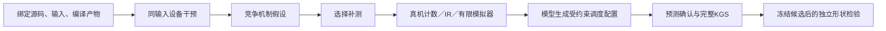

# 设备机制闭环：矩阵乘与归约

本模块将HG-KDA从调用分派机制扩展到设备分块、缓冲、搬运粒度与归约组织。父版使用历史优化源码，Codex实现通用变换与策略，CC＋DeepSeek选择配置；成果不称为纯原生KG自动发现。

## 实现

- `prepare.py` 预登记开发与独立合同、父源码身份和配置空间。两组共享相同的必要兼容修复，旧失败批次不覆盖。
- `variants.py` 保留父数学内核，通过通用模板改变矩阵分块／分组／多缓冲、归约分块／FP16中间精度。边界mask按整除条件保留，未知布局回父路径。
- `probe.py` 捕获固定输入的Triton提交，交错测量设备kernel延迟，保存实际编译IR和配置失败。这里不测完整调用walltime。
- `diagnose.py` 比较受控干预，提出可验证假设。变体间比较需进一步配对确认，未将流水活跃比例直接解释为瓶颈原因。
- `collect_profile.py` 在KGS完整通过后采集真机和模拟器证据，绑定操作ID。只允许取消本次登记的请求；模拟器core0、2分钟，整项最多300秒。保留缺失、失败和超时，不重启共享服务。
- `check.py` 检查布局、keepdim、新指针、stream、输入不变性及归约特殊值，另用开发集同输入设备计时核验候选预测。矩阵乘数值合同为有限随机输入。
- `run.py` 在宿主tmux持卡锁连续执行；模型两组共用相同配置空间、起点、测量和两次候选预算。方法组额外获得机制诊断，配置由同一模板生成源码。独立集在选版冻结后运行，不用于调参。

真机数据用于确认效应和资源现象，IR用于关联编译机制，模拟器用于小范围指令／等待补测；三者不互相冒充。RTL暂只有统一证据接口中的预留层级，没有RTL执行器。当前没有设备关键路径重建或定量Roofline。

## 批次

当前批次为 `operators/campaigns/device-night-20261026-v11`。首批参考ABI不匹配，v2历史矩阵父版的pipeline路径在新形状上发生aicore超时；仅关闭单K迭代的多缓冲/unit_flag未解决v5完整评测超时，第二次日志定位到dual路径。v6对K<512共享使用既有通用数学内核，保留小形状合同；其连续输入通过，9项带步长输入触发UB溢出，v7增加两组共享的输入/权重/偏置连续适配。v7归约Definition误把可选参数设为必填；v8复用原始Definition并增加AST签名门禁，优先执行归约。v3采集文件名遮蔽stdlib profile，在导入torch时即失败；v4探针错误地统一使用1e-4相对容差，父版FP16出现11/1048576不匹配。后续对齐固定FlagGems测试精度：atol=1e-4×K，rtol为FP16 1e-3、BF16 0.016、FP32 1.3e-6，逐元素全部匹配；原失败保留。`measure.py`将两个单kernel函数放在同次profiling，保留task_time原件，核对任务数、kernel身份并独立重算时间。真实进展以 `stage-state.json`、`state.json`、冻结文件和评测回执为准，启动队列不代表完成。

设备使用物理卡7、容器`tle_yy`、KGS19659与项目互斥锁。工作环境和源码树不修改共享镜像，不影响他人服务。

## 核验与交付

`audit.py`只读核对冻结、模板重建、模型原始回执、完整评测、同case延迟与选版；`audit_artifacts.py`独立核对IR／二进制／KGS附件的SHA与长度，并从原始task_time CSV重算设备时间、关联到探针及候选汇总。后者可直接读取完整原件归档，避免Windows长路径导致遗漏。两个工具均不参与诊断或选版。

`report.py`从两份通过的核验与原始完整结果生成中文报告、逐case CSV、模型成本和实际采集状态。设备时间、完整调用、独立形状与原项目FlagGems合同分别报告；父版含历史优化和共享修复，不标为原版FlagGems。

`reproduce.py --batch 批次 --operator amin --arm mechanism --split heldout --output /data/hanle/ascend-optimization/runs/新目录`在910B宿主复现冻结源码，先核对方法与合同身份，再做18项补充语义、开发设备确认和所选合同的一次完整KGS，不重新调用模型。用宿主已有venv执行；矩阵乘改为`--operator matmul_bias_activation`。

## 语义修复与版本

v8的两个归约候选在NaN补充检查中均为9/18。固定Triton的minimum默认忽略NaN，min组合器也使用该默认值。v11两组共享显式传播NaN的minimum与reduce组合器；显式reduce同时去掉低精度输入的隐式扩展，这部分不计为模型搜索收益。

v9/v10在新增父版预检中暴露工具导入冲突，均在算子提交前终止。v11明确本模块优先、mechanism辅助路径在后，并增加导入回归。父版先做18项语义预检；候选失败立即返回，不继续设备采集。FP16原生中间轴实际BR为配置middle_br的两倍，FP32/BF16为配置值，默认组织由此与父版对齐。模型输入包含最终wrapper模板与实际绑定常量。

`evidence_layers.py`在采集后只读导出绑定源码、输入、附件和单位的真机／IR／模拟器证据。RTL仅登记适配字段与not_run状态；该导出未改变本批模型输入或选版。

## 本轮交付与计时

结果见[设备机制系统闭环](../../../../operators/设备机制系统闭环-20261026.md)及[批次详细报告](../../../../operators/campaigns/device-night-20261026-v11/delivery/报告.md)。归约取得新设备收益；矩阵乘本轮候选变慢，保留历史优化父版。两组预算各为每算子两次，独立形状在选版冻结后评测，失败不删除。

Native合同是完整调用walltime；原项目FlagGems合同是默认KERNEL模式的设备计时。evaluate-operator.py的timing-scope只记录标签，本批原合同误记walltime，已在timing-scope-evidence/及报告中更正，原始字节保留。后续调用方应按实际benchmark记录device_kernel。

`finalize.py`可在主队列结束后自动执行无NPU的核验、证据导出和报告，服务器tmux独立于控制端。`delivery/ledger.json`登记实际事后工具SHA；`postflight-tools-snapshot/`保全对应字节，`shared-dependency-snapshot/`保全共享依赖，补充记录见postflight-extension.json。完整原始最终包与可移植性补充包分别封存，不相互覆盖。
