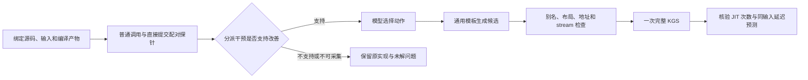

# HG-KDA 机制诊断原型：分派干预与受约束变换

本模块把“怀疑瓶颈”落实为可检验的干预：保持设备编译产物与 grid 不变，比较普通调用和直接提交；只有干预支持时，才缓存编译对象并在每次调用重新绑定输入和 stream。开发对象为 `selu_`，冻结后独立检验对象为 `asinh_`。

结果和复现入口见[机制闭环报告](../../../../operators/机制闭环原型-20261026.md)。正式批次为 `mechanism-compiler-20261026-v2` 和 `mechanism-heldout-asinh-20261026`。早期 pilot、未执行草稿、`sigmoid_` 正确性失败和 `tanh_` 接口不支持记录全部保留。



`probe.py` 保存同输入的交错计时、编译产物身份、调用符号、grid 和 trace；`core.py` 生成调用关系与竞争假设，`../rewrite-dispatch.py` 将有证据支持的动作变成源码，`check.py` 检查21组补充语义及调用路径变化。`../run-mechanism-compiler.py` 通过 tmux、物理卡7互斥锁和现有 KGS 串行执行；`../audit-mechanism.py` 离线核验冻结身份、源码谱系、模型来源和原始归档。

分派门槛为所有配对样本的“普通调用÷直接提交”均大于1.15；分块探针门槛为所有配对收益大于1.10。这是预先登记的经验门槛，非置信区间。最终交付采用分派变换，未把分块搜索编译进交付模板。

对照组获得相同起点、接口知识和原始探针，模型自由生成源码；方法组额外获得机制诊断，模型选择受限动作，由模板实现。两组各一次候选机会，允许一次格式修正，正式评测一次。这是“机制诊断＋受约束变换”的组合系统比较，不单独测量执行图的贡献，也不称为纯原生 KG 对照。

在910B宿主机运行交付源码，无需再次调用模型：

```bash
p=/data/hanle/ascend-optimization/Ascend-Optimization/project/Ascend-Optimization-v1
py=/data/hanle/ascend-optimization/runtime/kg-controller/venv/bin/python3
"$py" "$p/tools/profiling/hgkda/reproduce-mechanism.py" \
  --batch mechanism-heldout-asinh-20261026 --operator asinh_ \
  --output /data/hanle/ascend-optimization/runs/机制复现-新目录
```

输出目录必须不存在；入口先核对交付身份，再做21项补充检查和一次完整 KGS。入口已做语法检查；交付候选已在原批次实际完成检查和评测，没有为检查入口额外重复正式测试。

本轮实现的是 wrapper→JIT→运行时提交→设备→完成的调用语义链。没有设备内部指令依赖重建、资源时序重建或定量 Roofline；同步 walltime 不是纯设备时间。变换依赖固定 FlagTree 的私有启动 ABI，版本升级须重新检验。
